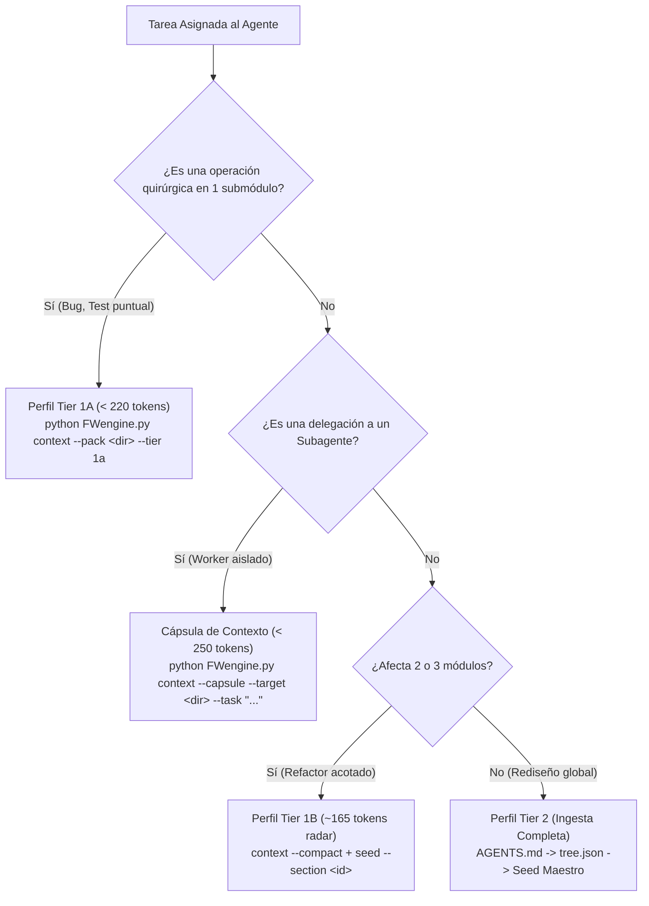

# iContext Federation Protocol v5.0: Manual de Arquitectura Cognitiva, Guía de Gobernanza Multi-Proyecto y Tutorial Operativo

```
+---------------------------------------------------------------------------------------------------+
|                            iCONTEXT FEDERATION PROTOCOL v5.0 (ARQUITECTURA)                       |
+---------------------------------------------------------------------------------------------------+
|  L0: TOPOLOGÍA FÍSICA & RUTEO       -->  iDirectory v5.0       (/idir, /dir)                      |
|  L1: MEMORIA SEMÁNTICA & ADN AST    -->  ThinkingSeed v5.0     (/seedMaster, /seed)               |
|  L2: TELEMETRÍA FORENSE & FPAI      -->  MetricsThinking v5.0  (/metrics)                         |
|  L3: SÍNTESIS EJECUTIVA & ACADÉMICA -->  iReadme v5.0          (/readme)                          |
+---------------------------------------------------------------------------------------------------+
|  CANAL DE ESTADO COMPARTIDO         -->  .context/icontext_bus.json & .context/contracts_ast.json  |
|  ORQUESTADOR MAESTRO UNIVERSAL      -->  icontext.py & audit_federation.py                        |
+---------------------------------------------------------------------------------------------------+
```

---

## 1. Explicación y Propósito del Protocolo

El **iContext Federation Protocol v5.0** (diseñado por **Gravity HyperScale Thinking**) es un estándar unificado de **Ingeniería de Contexto** (*Context Engineering*) y gobernanza atencional diseñado específicamente para optimizar la inferencia, continuidad y precisión de agentes autónomos y modelos de lenguaje avanzados (LLMs) como **Google Gemini / Antigravity**, **Anthropic Claude Code**, **OpenAI Codex**, **Cursor**, **Windsurf** y **GitHub Copilot**.

### 1.1 El Problema Fundamental: Degradación Atencional y Redundancia
En proyectos de ingeniería de software de frontera, los agentes de IA sufren frecuentemente de dos patologías críticas:
1. **Deriva Atencional y Sumidero (*Context Drift & Attention Sink*):** La inyección indiscriminada de miles de líneas de código fuente o árboles de archivos masivos agota la ventana de contexto efectiva del modelo, incrementa los costes computacionales y dispara la tasa de alucinaciones en tareas quirúrgicas (*Lost-in-the-Middle*).
2. **Escaneos Redundantes y Re-computación (*Blind Scans*):** Cuando múltiples herramientas de arquitectura, análisis métrico y documentación operan de forma aislada, cada una re-escanea recursivamente el disco (`ls -R`, `find .`, AST walk completo), compitiendo por recursos y generando representaciones desalineadas de la misma realidad física.

### 1.2 La Tesis v5.0: Autonomía 100% Standalone + Federación Cognitiva Zero-Scan
El protocolo v5.0 resuelve esta tensión mediante un principio rector dual:
- **Autonomía 100% Standalone:** Cada proyecto (`iDirectory`, `ThinkingSeed`, `MetricsThinking`, `iReadme`) puede ser instalado y ejecutado de manera totalmente independiente en cualquier repositorio o terminal sin requerir la presencia de los demás.
- **Federación Cognitiva Unificada (Zero Redundant Scans):** Cuando dos o más de estas herramientas coexisten en el mismo workspace, comparten un **plano de control estandarizado** (`.context/icontext_bus.json` e índice `.context/contracts_ast.json`). La capa física (L0) extrae las firmas y el hash topológico una sola vez; las capas superiores (L1, L2, L3) consumen esa telemetría determinista en tiempo constante $\mathcal{O}(1)$ sin volver a escanear el filesystem.

---

## 2. Fundamentos y Principios Teóricos

### 2.1 Principio de Menor Privilegio Contextual (Perfiles Adaptativos)
Ningún agente debe recibir más contexto del estrictamente necesario para la tarea actual:
- **Tier 1A (Operación Quirúrgica Atómica, < 220 tokens):** Empleado para resolución de bugs, edición de funciones puntuales o tests en un submódulo conocido. Carga únicamente el subgrafo inmediato (`FWengine.py map --slice <dir>`) y el beacon resuelto. **Prohibida la precarga del Seed Maestro** (`tier1_preload: false`).
- **Tier 1B (Cambio Multiarchivo o `/plan` Acotado, ~165 tokens radar):** Empleado para refactorizaciones acotadas entre 2 o 3 módulos. Carga el radar compacto (`FWengine.py context --compact`) y permite lectura seccional del ADN arquitectónico (`FWengine.py seed --toc` y `--section <id>`).
- **Tier 2 (Planificación Arquitectónica Global / Auditoría Forense Mayor):** Ingesta profunda del Seed activada únicamente ante rediseño transversal multi-dominio, comandos explícitos (`/seedMaster`, `/metrics`, `/ultraThinking`) o declaración obligatoria en el beacon (`seed_reference: required`).
- **Cápsula de Contexto Quirúrgica (< 250 tokens):** Paquete autocontenido para delegación a subagentes (`FWengine.py context --capsule --target <dir> --task "<task>"`), el cual incluye exclusivamente el beacon del módulo objetivo, las firmas AST públicas locales y las invariantes de gobernanza críticas, eliminando búsquedas recursivas (`ls -R`).

### 2.2 Invariante Zero Source Code (ADN Simbólico AST)
Las semillas arquitectónicas (`01_seed/seed-*-master.md`) y los índices de federación contienen **estrictamente firmas simbólicas tipadas de una sola línea**, sin cuerpos de función ni bloques de código de implementación:
$$\text{Firma Simbólica: } \texttt{ruta/modulo.py::simbolo(arg: Tipo) -> Retorno | Invariante / Efecto}$$
Esto reduce el consumo de tokens en un **95% a 99%** en comparación con la ingesta del código fuente completo, permitiendo que el LLM retenga la imagen estructural completa del sistema en memoria de trabajo sin agotar su contexto.

### 2.3 Conservación Criptográfica y Sincronización Topológica
La integridad física del repositorio se sella mediante una huella criptográfica SHA-256 (`topology_hash`):
$$\mathcal{H}_{\text{topo}} = \text{SHA256}\left(\bigoplus_{i=1}^N \text{SHA256}(path_i \parallel mtime_i \parallel size_i)\right)$$
Si $\mathcal{H}_{\text{topo}}$ no ha variado, el índice `.context/contracts_ast.json` y el satélite `.context/tree.json` se consideran matemáticamente frescos, garantizando que ninguna herramienta posterior requiera re-analizar los módulos fuente.

### 2.4 Vector de Eficiencia Contextual Espectral FPAI (First-Principles AI)
MetricsThinking (L2) modela el consumo de contexto como un sistema electromagnético de potencia aparente:
$$S_{\text{spectral}} = \sqrt{P^2 + (Q_{\text{dead}} + Q_{\text{dup}})^2 + D^2}$$
$$PF_{\text{spectral}} = \min\left(1.0, \frac{P}{S_{\text{spectral}}} \times G\right)$$
Donde:
- $P$ = Tokens activos productivos (código y directivas vigentes).
- $Q_{\text{dead}}$ = Tokens reactivos inertes (directorios ignorados o documentación huérfana).
- $Q_{\text{dup}}$ = Tokens duplicados entre módulos.
- $D$ = Tokens de distorsión y deriva semántica (firmas AST en código que difieren de la Sección 4.1 del Seed).
- $G \in \{0.0, 1.0\}$ = Compuerta Zero-Tolerance de seguridad (se anula si hay secretos o claves expuestas).
- **Meta Operativa:** Factor de potencia $PF_{\text{spectral}} \ge 0.70$.

---

## 3. Topología de Interacción y Canal Compartido

```
[Repositorio de Proyecto]
├── .context/
│   ├── tree.json               # Satélite topológico L0 con topology_hash y node_hashes
│   ├── contracts_ast.json      # Índice compartido L0 de contratos y firmas AST públicas
│   ├── icontext_bus.json       # Bus de estado federado L0 <-> L1 <-> L2 <-> L3 (Validado por Schema)
│   ├── checkpoint.json         # Continuidad atencional de sesiones multi-fase (< 300 tokens)
│   └── cache/                  # Diagnósticos volátiles excluidos del satélite (Cero Deriva)
│       └── benchmark_seed_coverage.md
├── .context.yaml               # Beacons jerárquicos por directorio (purpose, instructions, key_files)
├── config/
│   └── context_policy.json     # Política canónica única de gobernanza y presupuestos de tokens
├── schemas/
│   ├── icontext_bus.schema.json# JSON Schema estricto del bus de federación
│   ├── contracts_ast.schema.json# JSON Schema estricto del índice de contratos AST
│   ├── tree.schema.json        # JSON Schema del satélite topológico
│   ├── beacon.schema.json      # JSON Schema de beacons
│   ├── checkpoint.schema.json  # JSON Schema de checkpoints
│   └── plan_metadata.schema.json# JSON Schema de planes de inferencia
├── 01_seed/
│   └── seed-[repo]-master.md   # ADN arquitectónico L1 (XML envelope, Zero-Code, Section 4.1)
├── artifacts/
│   └── plans/
│       ├── active/
│       │   └── INFERRED_ROADMAP.md # Roadmap L2 compatible con plan_metadata.schema.json
│       ├── metricsthinking/    # Espejo canónico de telemetría forense L2
│       └── archive/            # Planes históricos podados (crawl: false)
└── README.md & README_ES.md    # Síntesis L3 bilingüe con badges federados y paridad phi = 1.0
```

### 3.1 El Bus de Federación: `.context/icontext_bus.json`
El bus es el corazón de la comunicación inter-herramientas. Cuenta con **escritura atómica segura contra condiciones de carrera multi-proceso** en Windows NTFS y valida estrictamente contra [`schemas/icontext_bus.schema.json`](./iDirectory/schemas/icontext_bus.schema.json):

```json
{
  "$schema": "../schemas/icontext_bus.schema.json",
  "protocol_version": "5.0.0",
  "project": "MiProyecto",
  "updated_at": "2026-10-29T18:25:00Z",
  "layers": {
    "l0_idirectory": {
      "version": "5.0.0",
      "topology_hash": "588cab510a567f61...",
      "contracts_ast_hash": "e24cd3bbc9cd3a9a...",
      "active_nodes_count": 19,
      "pruned_nodes_count": 8,
      "active_tokens_estimate": 60954
    },
    "l1_thinkingseed": {
      "present": true,
      "version": "5.0",
      "seed_path": "./01_seed/seed-MiProyecto-master.md",
      "ast_coverage_pct": 100.0,
      "gates_passed": "6/6 GATES OK",
      "freshness_status": "SYNCED"
    },
    "l2_metricsthinking": {
      "present": true,
      "version": "5.0.0",
      "report_path": "./MetricsThinking.md",
      "consolidated_score": 100.0,
      "maturity_band": "Excelencia Operativa / Producción (90.0% - 100.0%)",
      "fpai_pf_spectral": 1.0,
      "attack_surface_index": 0.0
    },
    "l3_ireadme": {
      "present": true,
      "version": "5.0.0",
      "standard": "Enterprise Paper-Grade v5.0",
      "readme_en_path": "./README.md",
      "readme_es_path": "./README_ES.md",
      "parity_score_phi": 1.0,
      "path_leakage_rate": 0.0,
      "zero_local_paths_verified": true,
      "katex_valid": true
    }
  }
}
```

---

## 4. Guía Didáctica: El Orden de Ejecución Canónico

¿En qué orden se deben ejecutar las herramientas y por qué? El protocolo define una secuencia matemática de 5 fases para garantizar **cero re-escaneos** y **cero deriva satelital**:

```
+----------------------------------------------------------------------------------------------------+
|                      SECUENCIA DIDÁCTICA CANÓNICA DE EJECUCIÓN (5 PASOS)                           |
+----------------------------------------------------------------------------------------------------+
|                                                                                                    |
|  [PASO 1] L0: iDirectory (FWengine.py reconcile)                                                   |
|           • ¿Por qué primero? Porque escanea el disco 1 sola vez, crea beacons, genera tree.json    |
|             y extrae todas las firmas públicas a contracts_ast.json.                               |
|                                     │                                                              |
|                                     ▼                                                              |
|  [PASO 2] L1: ThinkingSeed (test_seed_coverage.py)                                                 |
|           • ¿Por qué segundo? Porque valida que el Seed Maestro contenga el 100% de las firmas     |
|             públicas de contracts_ast.json sin tocar el filesystem, y publica su estado al bus.   |
|                                     │                                                              |
|                                     ▼                                                              |
|  [PASO 3] L2: MetricsThinking (metricsthinking.cli audit)                                          |
|           • ¿Por qué tercero? Porque audita el código contra el Seed de L1, calcula la telemetría  |
|             espectral FPAI (PF_spectral) y la inyecta en el bus federado.                          |
|                                     │                                                              |
|                                     ▼                                                              |
|  [PASO 4] L3: iReadme (generator.py / init_readme.py)                                              |
|           • ¿Por qué cuarto? Porque el generador lee icontext_bus.json con los datos consolidados  |
|             de L0, L1 y L2, e inyecta los escudos/badges y la sección de gobernanza federada.      |
|                                     │                                                              |
|                                     ▼                                                              |
|  [PASO 5] SELLADO FINAL L0 (FWengine.py reconcile)                                                 |
|           • ¿Por qué al final? Porque al haberse generado los READMEs y reportes, L0 recalcula      |
|             el topology_hash final y sella el repositorio garantizando 0 drift (satélite al día).  |
|                                                                                                    |
+----------------------------------------------------------------------------------------------------+
```

---

## 5. El Atajo Maestro de 1 Clic (Recomendado para Uso Cotidiano)

El orquestador universal central [`icontext.py`](./icontext.py) y el auditor [`audit_federation.py`](./audit_federation.py) operan con **sensibilidad contextual automática (modelo tipo `git`)**:
- **Si los ejecutas dentro de cualquier repositorio o directorio de trabajo (`CWD`):**  
  Operan directamente sobre ese repositorio, ejecutando el ciclo completo o mostrando el estado detallado de ese proyecto local.
- **Si los ejecutas en la raíz del ecosistema o añades la bandera `--all`:**  
  Operan simultáneamente sobre los 4 repositorios centrales de la federación (`iDirectory`, `ThinkingSeed`, `MetricsThinking`, `iReadme`).

---

### 5.1 Estado Instantáneo en Vivo y Trazabilidad Temporal (`status`)
Antes de hacer cambios o al iniciar una sesión agéntica, consulta la salud, timestamps y frescura del repositorio:

```powershell
# Inspecciona el repositorio actual donde estás ubicado (CWD):
python "D:\0001 HyperScale Thinking\PROYECTOS CLOUD\iContext\icontext.py" status

# O inspecciona todos los proyectos de la federación:
python "D:\0001 HyperScale Thinking\PROYECTOS CLOUD\iContext\icontext.py" status --all
```

#### ¿Qué información proporciona la tarjeta de estado del repositorio?
- **Topología Física & Satélite (L0):** Estado (`FRESH` al día o `DRIFT` desactualizado), `topology_hash` y tiempo relativo transcurrido desde la última reconciliación ("hace 5 minutos").
- **Trazabilidad de Beacons:** Cantidad total de balizas `.context.yaml`, cuántas han sido enriquecidas semánticamente y fecha/ruta del último beacon modificado o enriquecido.
- **Telemetría de Capas del Bus Federado:**
  - L0 Tokens Activos estimados y nodos.
  - L1 ThinkingSeed: Cobertura AST (%), estado de frescura y última validación de gates.
  - L2 MetricsThinking: Score de madurez (%), $PF_{\text{spectral}}$ y fecha de última auditoría forense.
  - L3 iReadme: Paridad $\phi$, tasa de fuga de rutas (%) y fecha de última sincronización.
- **Checkpoint de Sesión:** Plan activo, fase y siguiente acción recomendada para continuidad atencional.

---

### 5.2 Sincronización y Reconciliación Total 1-Click (`sync` / `reconcile`)
Ejecuta el ciclo determinista completo de 5 fases en el repositorio actual o en toda la federación:

```powershell
# Sincroniza y sella el repositorio actual (CWD):
python "D:\0001 HyperScale Thinking\PROYECTOS CLOUD\iContext\icontext.py" sync

# O sincroniza los 4 repositorios centrales de la federación:
python "D:\0001 HyperScale Thinking\PROYECTOS CLOUD\iContext\icontext.py" sync --all
```

#### ¿Qué hace internamente este comando en las 5 fases deterministas?
1. **Fase 1 (L0 iDirectory):** Si el proyecto es nuevo, auto-scaffoldea el andamiaje (`.context/`, `.context.yaml`, `config/context_policy.json`). Normaliza casing en Windows NTFS, genera el satélite `tree.json` y extrae firmas a `contracts_ast.json`.
2. **Fase 2 (L1 ThinkingSeed):** Si existe `01_seed/`, ejecuta la validación de 6 Gates reutilizando `contracts_ast.json` en tiempo $\mathcal{O}(1)$ y actualiza el bus.
3. **Fase 3 (L2 MetricsThinking):** Ejecuta la auditoría forense FPAI espectral (`metricsthinking.cli audit --profile default`), calculando $PF_{\text{spectral}}$ y publicando en el bus.
4. **Fase 4 (L3 iReadme):** Ejecuta el generador paramétrico `generator.py` para sincronizar `README.md` y `README_ES.md` con badges federados y la sección de gobernanza.
5. **Fase 5 (L0 Sellado Final):** Re-sella el satélite `tree.json` para garantizar **0 drift** tras la generación de documentación.

---

### 5.3 Inicialización Directa de Nuevos Proyectos (`init`)
Para incorporar la gobernanza L0 en un proyecto nuevo desde cero:

```powershell
# En la carpeta del proyecto nuevo:
python "D:\0001 HyperScale Thinking\PROYECTOS CLOUD\iContext\icontext.py" init

# O especificando la ruta:
python "D:\0001 HyperScale Thinking\PROYECTOS CLOUD\iContext\icontext.py" init "C:\Ruta\Al\NuevoProyecto"
```

---

### 5.4 Auditoría de Cumplimiento de Gobernanza (`audit`)
Verifica deterministamente que las 4 capas cumplan con sus contratos:

```powershell
# Audita el repositorio actual (CWD):
python "D:\0001 HyperScale Thinking\PROYECTOS CLOUD\iContext\audit_federation.py"

# O audita los 4 proyectos centrales de la federación:
python "D:\0001 HyperScale Thinking\PROYECTOS CLOUD\iContext\audit_federation.py" --all
```
*Resultado esperado:* `[ PASS ]` en L0, L1, L2 y L3, certificando el estado `COMPLIANT`.

---

### 5.5 Flujo de Enriquecimiento Agéntico Posterior (`/idir enrich`)
La sincronización determinista es completamente compatible con el enriquecimiento semántico:
1. Tras ejecutar `icontext.py sync`, puedes usar el skill `/idir enrich <carpeta>` o editar directamente `<carpeta>/.context.yaml` para añadir descripciones detalladas de `purpose`, `instructions` o firmas en `key_files`.
2. Al ejecutar nuevamente `icontext.py sync`, el motor **preserva el 100% de tu enriquecimiento agéntico** y re-sella la topología criptográfica.
3. Al consultar `icontext.py status`, verás reflejado el incremento en la métrica `Beacons enriquecidos` y la marca de tiempo de cuándo fue editado.

---

## 6. Guía Operativa Paso a Paso por Repositorio (Comandos con Rutas Completas)

Para usuarios, ingenieros o agentes que requieran operar o actualizar quirúrgicamente un repositorio individual, esta sección lista los comandos exactos en el orden estricto de ejecución.

---

### 6.1 Repositorio 1: `iDirectory` (Capa L0 — Topología & Ruteo)
**Directorio Base:** `D:\0001 HyperScale Thinking\PROYECTOS CLOUD\iContext\iDirectory`

#### Paso 1: Reconciliación y Sincronización de Topología L0
Crea/actualiza beacons `.context.yaml`, extrae firmas públicas a `contracts_ast.json`, recalcula `tree.json` y sincroniza el bus:
```powershell
cd "D:\0001 HyperScale Thinking\PROYECTOS CLOUD\iContext\iDirectory"
python "D:\0001 HyperScale Thinking\PROYECTOS CLOUD\iContext\iDirectory\FWengine.py" reconcile
```

#### Paso 2: Verificación de Cero Deriva Satelital (Dry-Run)
Verifica que la topología física coincida exactamente con el satélite:
```powershell
python "D:\0001 HyperScale Thinking\PROYECTOS CLOUD\iContext\iDirectory\FWengine.py" reconcile --check
```
*Criterio de éxito:* Mensaje `[PASS] Auditoría exitosa: 0 violaciones topológicas, beacons válidos y satélite al día.`

#### Paso 3: Validación del Seed Maestro de iDirectory
```powershell
python "D:\0001 HyperScale Thinking\PROYECTOS CLOUD\iContext\ThinkingSeed\scripts\test_seed_coverage.py" --target-repo . --no-anonymize
```
*Criterio de éxito:* `6/6 GATES OK` y `ast_coverage_pct: 100.0%`.

#### Paso 4: Generación de Cápsula Quirúrgica para Subagentes (Demo Didáctica)
Si vas a delegar una tarea en un submódulo (por ejemplo, `schemas/`), emite su cápsula aislada (< 250 tokens):
```powershell
python "D:\0001 HyperScale Thinking\PROYECTOS CLOUD\iContext\iDirectory\FWengine.py" context --capsule --target schemas --task "Añadir directiva en beacon"
```

---

### 6.2 Repositorio 2: `ThinkingSeed` (Capa L1 — ADN Semántico & Gates)
**Directorio Base:** `D:\0001 HyperScale Thinking\PROYECTOS CLOUD\iContext\ThinkingSeed`

#### Paso 1: Reconciliación L0 en ThinkingSeed
```powershell
cd "D:\0001 HyperScale Thinking\PROYECTOS CLOUD\iContext\ThinkingSeed"
python "D:\0001 HyperScale Thinking\PROYECTOS CLOUD\iContext\ThinkingSeed\FWengine.py" reconcile
```

#### Paso 2: Ejecución de los 6 Gates Deterministas
Valida el ADN arquitectónico (`01_seed/seed-ThinkingSeed-master.md`), verifica que no contenga código fuente de implementación (Zero-Code) y actualiza el bus:
```powershell
python "D:\0001 HyperScale Thinking\PROYECTOS CLOUD\iContext\ThinkingSeed\scripts\test_seed_coverage.py" --target-repo . --no-anonymize
```
*Nota didáctica:* Este comando escribe su informe de rendimiento en `.context/cache/benchmark_seed_coverage.md` para **no ensuciar** la carpeta `artifacts/` ni causar deriva satelital.

#### Paso 3: Ejecución de Tests Unitarios
```powershell
python -m pytest "D:\0001 HyperScale Thinking\PROYECTOS CLOUD\iContext\ThinkingSeed\tests\test_validators.py"
```
*Criterio de éxito:* 6 tests aprobados (`6 passed`).

#### Paso 4: Sellado de Cierre
```powershell
python "D:\0001 HyperScale Thinking\PROYECTOS CLOUD\iContext\ThinkingSeed\FWengine.py" reconcile
```

---

### 6.3 Repositorio 3: `MetricsThinking` (Capa L2 — Auditoría Forense & FPAI)
**Directorio Base:** `D:\0001 HyperScale Thinking\PROYECTOS CLOUD\iContext\MetricsThinking`

#### Paso 1: Reconciliación L0 en MetricsThinking
```powershell
cd "D:\0001 HyperScale Thinking\PROYECTOS CLOUD\iContext\MetricsThinking"
python "D:\0001 HyperScale Thinking\PROYECTOS CLOUD\iContext\MetricsThinking\FWengine.py" reconcile
```

#### Paso 2: Fase 0 - Sonda Ligera de Arquetipo (< 100 ms)
Detecta el perfil de ingeniería sin cargar archivos pesados en el contexto:
```powershell
python -m metricsthinking.cli probe --target . --json
```

#### Paso 3: Auditoría Forense Integral y Cálculo Espectral FPAI
Evalúa los 10 módulos canónicos (M01-M10), audita la deriva semántica contra el Seed Maestro, genera `MetricsThinking.md` y publica la capa `l2_metricsthinking` en el bus federado:
```powershell
python -m metricsthinking.cli audit --target . --profile default
```
*Criterio de éxito:* Reporte generado con $PF_{\text{spectral}} = 1.0$ y score $\ge 90\%$.

#### Paso 4: Ejecución de la Suite de Pruebas Unitarias
```powershell
python -m pytest "D:\0001 HyperScale Thinking\PROYECTOS CLOUD\iContext\MetricsThinking\tests"
```
*Criterio de éxito:* 106 tests aprobados (`106 passed`).

#### Paso 5: Sellado de Cierre L0
Dado que la auditoría generó `MetricsThinking.json` y `MetricsThinking.md`, ejecutamos el sellado para sincronizar el satélite:
```powershell
python "D:\0001 HyperScale Thinking\PROYECTOS CLOUD\iContext\MetricsThinking\FWengine.py" reconcile
```

---

### 6.4 Repositorio 4: `iReadme` (Capa L3 — Documentación Paper-Grade Dual)
**Directorio Base:** `D:\0001 HyperScale Thinking\PROYECTOS CLOUD\iContext\iReadme`

#### Paso 1: Reconciliación L0 en iReadme
```powershell
cd "D:\0001 HyperScale Thinking\PROYECTOS CLOUD\iContext\iReadme"
python "D:\0001 HyperScale Thinking\PROYECTOS CLOUD\iContext\iReadme\FWengine.py" reconcile
```

#### Paso 2: Generación Dual con Badges de Gobernanza Federada
Ejecuta el generador dinámico que lee `.context/icontext_bus.json`, inyecta los escudos/badges monocromáticos y redacta la sección `Gobernanza Federada & Context Engineering iContext v5.0`:
```powershell
python "D:\0001 HyperScale Thinking\PROYECTOS CLOUD\iContext\iReadme\scripts\init_readme.py"
```

#### Paso 3: Ejecución de la Suite de Invariantes Paper-Grade
Valida la paridad bilingüe ($\Phi = 1.0$), fórmulas $\LaTeX$, ausencia de emojis y cero rutas absolutas:
```powershell
python -m pytest "D:\0001 HyperScale Thinking\PROYECTOS CLOUD\iContext\iReadme\tests"
```
*Criterio de éxito:* 12 tests aprobados (`12 passed`).

#### Paso 4: Sellado de Cierre L0
```powershell
python "D:\0001 HyperScale Thinking\PROYECTOS CLOUD\iContext\iReadme\FWengine.py" reconcile
```

---

## 7. Tutorial Didáctico: Cómo Integrar iContext v5.0 en un Nuevo Repositorio Externo

¿Tienes un nuevo proyecto de software o ciencia de datos y quieres que cuente con el máximo estándar de control de contexto? Sigue estos 5 pasos ordenados:

### Paso 1: Instalar la Capa L0 (iDirectory)
1. Copia los siguientes elementos desde `iDirectory` a la raíz de tu proyecto:
   - `FWengine.py`
   - La carpeta `schemas/`
   - La carpeta `config/context_policy.json`
2. Ejecuta el bootstrap de reconciliación en tu proyecto:
   ```powershell
   python FWengine.py reconcile
   ```
   *Efecto:* Se crearán automáticamente las balizas `.context.yaml` en cada subcarpeta, se generará el satélite `.context/tree.json` con su `topology_hash`, se extraerán las firmas a `.context/contracts_ast.json` y se inicializará `.context/icontext_bus.json`.

### Paso 2: Crear el ADN Semántico L1 (ThinkingSeed)
1. Crea la carpeta `01_seed/` en la raíz de tu proyecto.
2. En tu asistente de IA (Google Antigravity, Claude Code, Cursor), ejecuta la habilidad:
   ```
   /seedMaster
   ```
   Esto generará `./01_seed/seed-[tu_proyecto]-master.md` conteniendo las 11 secciones core con firmas AST tipadas de 1 línea y sin bloques de código fuente.
3. Valida el Seed ejecutando el inspector de 6 Gates:
   ```powershell
   python "D:\0001 HyperScale Thinking\PROYECTOS CLOUD\iContext\ThinkingSeed\scripts\test_seed_coverage.py" --target-repo . --no-anonymize
   ```

### Paso 3: Auditar y Medir Eficiencia L2 (MetricsThinking)
1. Ejecuta la auditoría forense apuntando a tu proyecto:
   ```powershell
   python -m metricsthinking.cli audit --target . --profile default
   ```
2. Revisa el reporte generado en `MetricsThinking.md` y confirma que la capa `l2_metricsthinking` haya quedado registrada en tu `.context/icontext_bus.json`.

### Paso 4: Generar la Documentación Paper-Grade L3 (iReadme)
1. Ejecuta el generador paramétrico universal apuntando a tu repositorio:
   ```powershell
   python "D:\0001 HyperScale Thinking\PROYECTOS CLOUD\iContext\iReadme\src\ireadme\generator.py" --target .
   ```
   *Efecto:* Se generarán `README.md` y `README_ES.md` con:
   - Badges de gobernanza activos según las capas detectadas en tu bus.
   - Topología ASCII generada a partir de tus beacons.
   - Tabla de benchmarks bimodales y métricas reales.
   - Sección dedicada: `Gobernanza Federada & Context Engineering (iContext v5.0)`.

### Paso 5: Sellado Criptográfico Final
Para concluir, ejecuta el sellado final que garantiza que tu satélite `tree.json` registre los archivos recién creados con cero deriva:
```powershell
python FWengine.py reconcile
```

---

## 8. Guía Didáctica para Agentes Autónomos: Prevención de Degradación Atencional

Cuando un modelo de lenguaje o agente interactúa con el repositorio, debe seguir este árbol de decisiones para no agotar su ventana de contexto:



### Reglas Críticas de Oro para Agentes:
1. **PROHIBIDO EL ESCANEO CIEGO (`[INV-02]`):** Jamás ejecutes `Get-ChildItem -Recurse`, `find .` o `ls -R`. Toda exploración debe ser dirigida mediante `map --slice <dir>` o `.context/tree.json`.
2. **CÁPSULAS PARA SUBAGENTES:** Al invocar un subagente, pásale como prompt la salida de `FWengine.py context --capsule --target <dir> --task "<task>"`. No le pases el historial previo de 40,000 tokens.
3. **CIERRE CON UN SOLO COMANDO:** Al terminar cualquier edición que mueva, cree o renombre archivos, ejecuta siempre `python FWengine.py reconcile`.

---

## 9. Diagnóstico y Auto-Sanación Rápida (Troubleshooting)

| Síntoma Observado | Causa Raíz | Solución Didáctica Inmediata |
| :--- | :--- | :--- |
| `[!] SATÉLITE OBSOLETO (DRIFT): cambio detectado en '...'` | Se modificó o creó un archivo en una ruta rastreada (`crawl: true`) y no se ha actualizado `tree.json`. | Ejecuta: `python FWengine.py reconcile` para actualizar el hash topológico. |
| `[!] Violación de Casing: directorio con mayúsculas` | Windows NTFS no distingue mayúsculas por defecto y se creó una carpeta como `Src/` o `Config/`. | Ejecuta: `python "D:\...\icontext.py" doctor` para renombrar de forma segura en dos pasos. |
| `[!] Esquema de bus inválido: 'present' is a required property` | Una herramienta escribió en `.context/icontext_bus.json` omitiendo claves obligatorias. | Ejecuta: `python "D:\...\icontext.py" sync` para restaurar los contratos de capa L0 a L3 conformes a `icontext_bus.schema.json`. |
| `[!] Gate 5 Falló: Cobertura AST < 90%` | Se añadieron nuevas funciones o clases en código pero no se documentaron en la Sección 4.1 del Seed Maestro. | Abre `01_seed/seed-*-master.md`, añade la firma simbólica de 1 línea en la Sección 4.1 y vuelve a ejecutar `test_seed_coverage.py`. |
| `[!] Subagente alucina o recorre carpetas masivas` | El subagente arrancó sin directivas y cayó en escaneo ciego recursivo. | Genera una cápsula con `python FWengine.py context --capsule --target <dir> --task "..."` e inyéctala como prompt inicial del subagente. |

---

## 10. Tabla Resumen de Comandos Rápidos

| Operación Deseada | Ámbito / Propósito | Comando de Terminal (Ruta Completa) |
| :--- | :--- | :--- |
| **Sincronización Total 1-Click** | Repositorio Actual (`CWD`) | `python "D:\0001 HyperScale Thinking\PROYECTOS CLOUD\iContext\icontext.py" sync` |
| **Sincronización de Toda la Federación** | Los 4 Repositorios Centrales | `python "D:\0001 HyperScale Thinking\PROYECTOS CLOUD\iContext\icontext.py" sync --all` |
| **Estado en Vivo y Trazabilidad Temporal** | Repositorio Actual (`CWD`) | `python "D:\0001 HyperScale Thinking\PROYECTOS CLOUD\iContext\icontext.py" status` |
| **Estado en Vivo del Ecosistema** | Los 4 Repositorios Centrales | `python "D:\0001 HyperScale Thinking\PROYECTOS CLOUD\iContext\icontext.py" status --all` |
| **Inicializar Nuevo Proyecto L0** | Directorio Actual o Ruta | `python "D:\0001 HyperScale Thinking\PROYECTOS CLOUD\iContext\icontext.py" init [ruta]` |
| **Auditoría Forense de Calidad** | Repositorio Actual (`CWD`) | `python "D:\0001 HyperScale Thinking\PROYECTOS CLOUD\iContext\audit_federation.py"` |
| **Auditoría Holística Global** | Los 4 Repositorios Centrales | `python "D:\0001 HyperScale Thinking\PROYECTOS CLOUD\iContext\audit_federation.py" --all` |
| **Auto-Sanación del Ecosistema** | Los 4 Repositorios Centrales | `python "D:\0001 HyperScale Thinking\PROYECTOS CLOUD\iContext\icontext.py" doctor` |
| **Cápsula para Subagentes (<250 tokens)**| Subdominio / Tarea Específica | `python FWengine.py context --capsule --target <dir> --task "<tarea>"` |
| **Validación de 6 Gates (Seed)** | Repositorio Actual | `python scripts/test_seed_coverage.py --target-repo . --no-anonymize` |
| **Auditoría Forense FPAI** | Repositorio Actual | `python -m metricsthinking.cli audit --target . --profile default` |
| **Generación Dual de READMEs** | Repositorio Actual | `python "D:\0001 HyperScale Thinking\PROYECTOS CLOUD\iContext\iReadme\src\ireadme\generator.py" --target .` |
