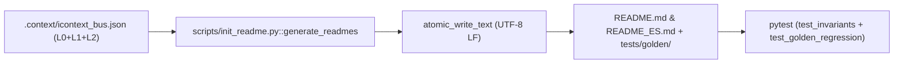

<SEED_ARCHITECTURAL_VECTOR version="6.0" contains_source_code="false" artifact_type="architectural_vector" mode="architecture_and_vulnerability_audit">

# THINKING SEED MASTER: iReadme

> **[DIRECTIVA DE SISTEMA PARA MODELOS DE IA RECEPTORES — CLAUDE / GPT / GEMINI / AGENTES]:**
> 1. **Naturaleza del Artefacto:** Este documento es un **Vector Arquitectónico y Memoria Técnica (ThinkingSeed Master v5.0)** con `contains_source_code="false"`. **NO es el repositorio de código fuente completo** ni un volcado truncado. La ausencia de bloques de código de implementación es una **invariante deliberada de ingeniería** para maximizar la densidad semántica y preservar más del 99% de tu ventana de contexto.
> 2. **Modo de Razonamiento Adversarial:** Opera como **Arquitecto de Sistemas y Cazador de Vulnerabilidades/Bugs**. Utiliza las firmas simbólicas (Sección 4) y la superficie de tensión (Sección 7) para detectar condiciones de carrera, acoplamientos frágiles y casos borde antes de proponer cambios.
> 3. **Estado de Avance Real:** Los componentes etiquetados como `[FALTANTE]` o `[DEUDA]` reflejan el trabajo en progreso (WIP) real del proyecto, no defectos de este documento.

## Seed Changelog
- `2026-10-31 (v6.0)`: [CONFIRMADO] Runtime versionado, evidencia incremental por contenido, skills portables, consultas sin escritura y actualización semántica por el agente actual. Los registros v3-v5 siguientes son históricos.
- `2026-10-28 (v5.0)`: Evolución integral a **iReadme v5.0 (iContext Federation Protocol v5.0 — Capa L3)**. Migración de la semilla desde v2.0 al estándar `<SEED_ARCHITECTURAL_VECTOR version="6.0" contains_source_code="false">`, erradicación de rutas absolutas locales (`repository_root: "./"`), normalización topológica `all-lowercase` (`./01_seed/`, `./02_foundation/`, `./tools/`), sincronización automática de `./tests/golden/README_golden.md` y `./tests/golden/README_ES_golden.md`, e integración con el Bus Cognitivo Federado `./.context/icontext_bus.json` (`l3_ireadme`).
- `2026-04-20 (v2.0)`: Inicialización bajo estándar Enterprise Paper-Grade v2.0 y suite de invariantes Pytest.

---

## 0. IDENTIDAD, METADATOS Y CONTRATO DEL RECEPTOR

```yaml
seed_schema_version: "6.0"
project_name: "iReadme"
repository_name: "iReadme"
project_type: "agent-skill"
repository_mode: "single-project"
generated_at: "2026-10-31T19:22:25.271058+00:00"
generated_by: "Codex / iContext v6 migration"
repository_root: "./"
git_branch: "main"
git_commit: "ff0503e"
working_tree_state: "dirty"
analysis_mode: "static+git+validated"
coverage_level: "high"
known_analysis_limits:
  - "La generación dinámica de READMEs en otros repositorios se ejecuta vía la skill /readme consumiendo el Bus Federado .context/icontext_bus.json; init_readme.py materializa y sincroniza los artefactos canónicos de este repositorio."
```

### 0.1 Instrucciones para el modelo receptor
1. **ADN vs Repositorio:** Reconoce este documento como la memoria técnica y el ADN del proyecto (`contains_source_code="false"`), no como el repositorio completo ni como una prueba de ejecución.
2. **Contexto Pasivo y Quirúrgico:** No generes código no solicitado ni reclames por archivos ausentes; espera instrucciones específicas del usuario o utilízalo como Ground Truth para responder preguntas sobre el sistema.
3. **Estado de Avance:** Considera que los componentes marcados como `[FALTANTE]` o `[DEUDA]` representan el avance real del proyecto y oportunidades de asistencia, no errores del documento.
4. **Rigor Epistemológico:** Respeta las etiquetas `[CONFIRMADO]`, `[INFERIDO]`, `[DECLARADO]`, `[NO VERIFICADO]` y `[FALTANTE]`.
5. **Portabilidad de Rutas:** Cita siempre rutas relativas a la raíz del repositorio (`./ruta/archivo`) con `/`. Prohibido emitir rutas locales absolutas o enlaces con esquema de archivo local.
6. **Contratos Simbólicos:** Conserva arquitectura, firmas simbólicas (Sección 4) e invariantes (`[INV-01]` a `[INV-06]`).
7. **Postura Adversarial Constructiva:** Revisa siempre la Sección 7 (Superficie de Tensión) antes de proponer cambios.
8. **Seguridad Zero-Trust:** No reveles ni solicites secretos. Usa placeholders (`<REDACTED>`).

---

## 1. RESUMEN EJECUTIVO Y ALCANCE

[CONFIRMADO] Mantiene documentación técnica bilingüe propia de cada proyecto. El agente redacta cambios semánticos y el generador conserva el contenido existente, actualiza su bloque de telemetría y separa la aceptación de referencias golden.

[CONFIRMADO] Puede operar sin clones de los otros repositorios. La federación comparte artefactos versionados y ContextControl coordina el flujo cuando está disponible.

## 2. ARQUITECTURA, TOPOLOGÍA Y FRONTERAS MODULARES

### 2.0 Estado vigente v6

[CONFIRMADO] En v6, FWengine.py es un lanzador y tools/icontext_runtime es una distribución generada. Los orígenes mantenidos están en iDirectory/src/core y ContextControl/src/core; las copias generadas se verifican por manifest. skills/v6 contiene bundles con scripts y recursos completos. Las capas siguen siendo L0 iDirectory, L1 ThinkingSeed, L2 MetricsThinking y L3 iReadme.
- **2.1 Patrón arquitectónico:** Pipeline determinista de generación atómica dual (`init_readme.py`) acoplado a una suite de verificación de invariantes (`tests/test_invariants.py`, `tests/test_golden_regression.py`) y un instalador multi-agente (`scripts/install_skill.py`) `[CONFIRMADO]`.
- **2.2 Mapa de módulos y directorios (`all-lowercase`):**
  - `./01_seed/`: Vector arquitectónico `seed-ireadme-master.md` `[CONFIRMADO]`.
  - `./02_foundation/engine/`: Manifiesto de gobernanza topológica `engine_readme.md` `[CONFIRMADO]`.
  - `./03_research/`: Subdirectorios `notebooks/`, `prompts/` y `experiments/` `[CONFIRMADO]`.
  - `./artifacts/plans/`: Subdirectorios `active/`, `metricsthinking/`, `backlog/` y `archive/` `[CONFIRMADO]`.
  - `./config/`: Configuración de gobernanza y política de contexto `context_policy.json` `[CONFIRMADO]`.
  - `./data/`: Capas locales `raw/`, `processed/` y `sandbox/` (`crawl: false`) `[CONFIRMADO]`.
  - `./docs/`: Documentación en `architecture/`, `specs/` y `notes/` `[CONFIRMADO]`.
  - `./schemas/`: Esquemas JSON Schema Draft-07 (`tree.schema.json`, `beacon.schema.json`, `checkpoint.schema.json`, `plan_metadata.schema.json`, `backlog.schema.json`, `icontext_bus.schema.json`, `contracts_ast.schema.json`) `[CONFIRMADO]`.
  - `./scripts/`: Automatización (`./scripts/init_readme.py`, `./scripts/install_skill.py`) `[CONFIRMADO]`.
  - `./skills/readme/`: Especificación maestra de la skill `./skills/readme/SKILL.md` `[CONFIRMADO]`.
  - `./src/`: Subdirectorios `core/`, `cloud_jobs/`, `dashboards/` y `data_generation/` `[CONFIRMADO]`.
  - `./tests/`: Suites `./tests/test_invariants.py`, `./tests/test_golden_regression.py`, `./tests/test_install_skill.py` y snapshots `./tests/golden/` `[CONFIRMADO]`.
  - `./tools/` y `./logs/`: Utilidades y trazas operativas `[CONFIRMADO]`.

---

## 3. FLUJOS DE EJECUCIÓN, ENTRY POINTS Y CICLO DE VIDA

### 3.0 Estado vigente v6

[CONFIRMADO] El flujo v6 es detectar cambios, actualizar evidencia L0, preparar SeedMaster, evaluar Metrics y preparar README. sync devuelve 3 cuando el agente debe redactar, 1 ante fallo requerido y 0 al completar. prepare es de lectura; complete rechaza hashes de entrada que hayan cambiado. Sin subcomando se muestra ayuda; las reparaciones requieren doctor --fix.
- **3.1 Entry points registrados:**
  - Generación y sincronización atómica dual: `python scripts/init_readme.py` `[CONFIRMADO]`.
  - Instalación multi-plataforma de la skill: `python scripts/install_skill.py --all` `[CONFIRMADO]`.
  - Suite de verificación e invariantes: `python -m pytest` `[CONFIRMADO]`.
  - Gobernanza topológica iDirectory v5.0: `python FWengine.py reconcile` `[CONFIRMADO]`.
- **3.2 Flujo principal E2E:**


---

## 4. CONTRATOS SIMBÓLICOS, MODELO DE DATOS Y PERSISTENCIA

### 4.1 Contratos públicos vigentes v6

[CONFIRMADO] Firmas simbólicas extraídas de archivos activos, con hash de contenido y versión del analizador.

- `./scripts/init_readme.py::./scripts/init_readme.py::atomic_write_text(file_path: Path, content: str, encoding: str='utf-8') -> None`
- `./scripts/init_readme.py::./scripts/init_readme.py::generate_readmes(root_dir: Path=ROOT_DIR, update_golden: bool=False) -> Any`
- `./scripts/install_skill.py::./scripts/install_skill.py::get_home_dir() -> Path`
- `./scripts/install_skill.py::./scripts/install_skill.py::install_to_antigravity() -> bool`
- `./scripts/install_skill.py::./scripts/install_skill.py::install_to_codex() -> bool`
- `./scripts/install_skill.py::./scripts/install_skill.py::install_to_claude() -> bool`
- `./scripts/install_skill.py::./scripts/install_skill.py::install_to_directory(dest_path: Path) -> bool`
- `./scripts/install_skill.py::./scripts/install_skill.py::main() -> Any`
- `./skills/v6/readme/scripts/run.py::./skills/v6/readme/scripts/run.py::matches_version(path) -> Any`
- `./src/ireadme/generator.py::./src/ireadme/generator.py::detect_icontext_layers(repo_path: Path) -> Dict[str, Dict[str, Any]]`
- `./src/ireadme/generator.py::./src/ireadme/generator.py::render_badges_block(layers: Dict[str, Dict[str, Any]], custom_badges: Optional[List[str]]=None) -> str`
- `./src/ireadme/generator.py::./src/ireadme/generator.py::render_federation_section(layers: Dict[str, Dict[str, Any]], lang: str='en') -> str`
- `./src/ireadme/generator.py::./src/ireadme/generator.py::atomic_write_text(target: Path, content: str, encoding: str='utf-8') -> None`
- `./src/ireadme/generator.py::./src/ireadme/generator.py::extract_project_metadata(repo_path: Path) -> Dict[str, Any]`
- `./src/ireadme/generator.py::./src/ireadme/generator.py::generate_universal_readmes(repo_path: Path, write_to_disk: bool=True, update_golden: bool=False) -> Tuple[str, str]`
- `./src/ireadme/generator.py::./src/ireadme/generator.py::main() -> Any`

CLI flags: `--all`, `--antigravity`, `--claude`, `--codex`, `--dry-run`, `--expand`, `--pack`, `--target`, `--target-dir`, `--tier`, `--update-golden`

### 4.2 Artefactos y propiedad de escritura

[CONFIRMADO] .context/orientation_cache.json conserva vistas compiladas; las consultas rápidas verifican poda y metadatos de archivos y declaran la generación registrada. El CLI usa UTF-8 en Windows.

[CONFIRMADO] .context/inventory.json mantiene evidencia; .context/contracts_ast.json conserva contratos; .context/layers contiene estados por productor y icontext_bus.json se agrega bajo bloqueo del repositorio. .context/sync_state.json registra entradas y salidas aceptadas. .context/update_request.json transfiere redacción pendiente. Los checkpoints de sesión tienen identidad, objetivo, restricciones, decisiones, evidencia y próxima acción.

## 5. CONFIGURACIÓN, ENTORNOS Y DEPENDENCIAS
- **5.1 Flags CLI soportados en `./scripts/install_skill.py`:** `--all`, `--antigravity`, `--claude`, `--target-dir` `[CONFIRMADO]`.
- **5.2 Dependencias (`./pyproject.toml`):** Runtime 100% Python Standard Library (`os`, `sys`, `shutil`, `tempfile`, `argparse`, `pathlib`, `json`, `datetime`); suite de pruebas con `pytest>=8.0.0` `[CONFIRMADO]`.

---

## 6. PRUEBAS, CI/CD, DESPLIEGUE Y OPERACIÓN
- **6.1 Suites de pruebas en `./tests/`:**
  - `./tests/test_invariants.py`: Verifica existencia, paridad estructural ($\Phi = 1.0$), ausencia de rutas absolutas locales, cero emojis, balance de delimitadores KaTeX (`$$`) y presencia de cita BibTeX `[CONFIRMADO]`.
  - `./tests/test_golden_regression.py`: Verifica determinismo exacto contra `./tests/golden/README_golden.md` y `./tests/golden/README_ES_golden.md` `[CONFIRMADO]`.
  - `./tests/test_install_skill.py`: Prueba unitaria del instalador multi-agente con redirección de `HOME` temporal `[CONFIRMADO]`.

---

## 7. SUPERFICIE DE TENSIÓN, CONTRADICCIONES Y MODOS DE FALLA

- [CONFIRMADO] La ruta rápida reutiliza tamaño y mtime_ns para evitar lecturas. La verificación --full recalcula contenidos, incluso ante timestamps restaurados; la consulta de estado registrada no certifica por sí sola la frescura física.
- [CONFIRMADO] Los contratos AST automáticos cubren Python a nivel de módulo. No equivalen a cobertura semántica de todos los lenguajes, cuerpos de funciones o comportamiento observado del producto.
- [CONFIRMADO] FPAI y el recuento heurístico de tokens son indicadores auxiliares. La distorsión y los resultados de atención no observados permanecen expresamente sin medir.
- [CONFIRMADO] complete comprueba estructura y contratos públicos; la exactitud narrativa requiere revisión del agente sobre la evidencia afectada. La ausencia de errores estructurales no demuestra ausencia de bugs.
- [CONFIRMADO] La agregación del bus usa bloqueo de proceso. El checkpoint compatible apunta a la última sesión seleccionada; la continuidad paralela debe usar identificadores de sesión explícitos.
- [CONFIRMADO] La paridad de bundles y sus comandos puede comprobarse sin invocar modelos. El éxito de tareas en sesiones reales de ambos proveedores requiere evidencia observada separada y no se presume de estas pruebas.

## 8. SEGURIDAD, PRIVACIDAD Y GUARDRAILS
- **8.1 Invariante Zero Local Paths:** El operador $\mathcal{E}(p)$ y `test_zero_absolute_paths` bloquean cualquier ruta de sistema operativo o URI local en los artefactos generados `[CONFIRMADO]`.
- **8.2 Política Zero-Trust de Secretos:** Ninguna credencial o API key se almacena en el repositorio; cualquier valor sensible se sanitiza con `<REDACTED>` `[CONFIRMADO]`.

---

## 9. ESTADO REAL, DEUDA TÉCNICA Y DECISIONES (ADRs)

### 9.0 Estado vigente v6

[CONFIRMADO] La migración v6 conserva los comandos compatibles y registra las pruebas y mediciones de esta entrega en .context/v6_validation.json y .context/benchmark_v6.json. Las reglas y workflows anteriores se conservan como referencias históricas podadas. La versión de cada proyecto puede fijarse en .context/toolchain.json.
- `[ADR-001]` **Escritura Atómica con `os.fsync`:** `atomic_write_text` previene lecturas parciales o corrupción de `README.md` y `README_ES.md` ante interrupciones de proceso `[CONFIRMADO]`.
- `[ADR-002]` **Integración con Bus Federado v5.0 (`l3_ireadme`):** `generate_readmes` publica el estado de paridad ($\Phi = 1.0$) y verificación KaTeX directamente en `./.context/icontext_bus.json` `[CONFIRMADO]`.

---

## 10. REGLAS DE MODIFICACIÓN, GLOSARIO E ÍNDICE DE EVIDENCIAS
- **10.1 Invariantes del Sistema:**
  - `[INV-01]` Paridad estructural 1:1 ($\Phi = 1.0$) entre `README.md` y `README_ES.md`.
  - `[INV-02]` Cero rutas locales absolutas y cero URIs de esquema de archivo local.
  - `[INV-03]` Cero emojis unicode en artefactos Paper-Grade.
  - `[INV-04]` Delimitadores matemáticos KaTeX (`$$`) estrictamente balanceados.
  - `[INV-05]` Topología física 100% `all-lowercase` sincronizada con `./.context/tree.json`.
  - `[INV-06]` Sanitización obligatoria `<REDACTED>` para cualquier secreto o token.

---

## 📌 CONTEXT HANDOFF & PROTOCOLO DE ASISTENCIA

> **Mensaje de orientación para el modelo de IA receptor:**
> "Esto es una semilla de proyecto (**ThinkingSeed Master v5.0**): el vector arquitectónico y ADN del proyecto (`contains_source_code="false"`), no su repositorio completo. Refleja el avance real, los contratos simbólicos y la superficie de tensión del sistema hasta la fecha. Como modelo receptor, tu función es usar esta semilla como memoria técnica para:
> 1. **Responder preguntas** sobre la arquitectura, contratos simbólicos, dependencias y flujos del sistema.
> 2. **Auditar riesgos y sugerir mejoras** evaluando activamente la Superficie de Tensión (Sección 7) y las áreas marcadas como `[DEUDA]` o `[FALTANTE]`.
> 3. **Generar código o soluciones compatibles** respetando las rutas relativas (`./`), firmas simbólicas e invariantes definidas aquí, cuando el usuario te lo solicite."

### 🤝 Acuse de Recibo Inicial
Si el usuario adjuntó esta semilla **sin una instrucción específica**, responde únicamente con:
1. Un saludo confirmando que asimilaste el ADN arquitectónico v5.0 de **iReadme** (`<SEED_ARCHITECTURAL_VECTOR>`) y su integración en la Capa L3 del protocolo **iContext Federation v5.0**.
2. Un breve resumen de 2-3 líneas sobre el motor de sincronización dual Paper-Grade (`init_readme.py`) y su suite de invariantes (`test_invariants.py`, `test_golden_regression.py`).
3. Una frase poniéndote a disposición para resolver dudas o colaborar en los siguientes pasos.

</SEED_ARCHITECTURAL_VECTOR>
