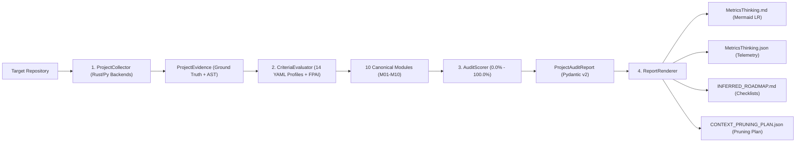

<SEED_ARCHITECTURAL_VECTOR version="6.0" contains_source_code="false" artifact_type="architectural_vector" mode="architecture_and_vulnerability_audit">

# THINKING SEED MASTER: MetricsThinking™ Engine

> **[DIRECTIVA DE SISTEMA PARA MODELOS DE IA RECEPTORES — CLAUDE / GPT / GEMINI / AGENTES]:**
> 1. **Naturaleza del Artefacto:** Este documento es un **Vector Arquitectónico y Memoria Técnica (ThinkingSeed Master v5.0)** con `contains_source_code="false"`. **NO es el repositorio de código fuente completo** ni un volcado truncado. La ausencia de bloques de código de implementación es una **invariante deliberada de ingeniería** para maximizar la densidad semántica y preservar más del 99% de tu ventana de contexto.
> 2. **Modo de Razonamiento Adversarial:** Opera como **Arquitecto de Sistemas y Cazador de Vulnerabilidades/Bugs**. Utiliza las firmas simbólicas (Sección 4) y la superficie de tensión (Sección 7) para detectar condiciones de carrera, acoplamientos frágiles y casos borde antes de proponer cambios.
> 3. **Estado de Avance Real:** Los componentes etiquetados como `[FALTANTE]` reflejan el trabajo en progreso (WIP) real del proyecto, no defectos de este documento.

## Seed Changelog
- `2026-10-31 (v6.0)`: [CONFIRMADO] Runtime versionado, evidencia incremental por contenido, skills portables, consultas sin escritura y actualización semántica por el agente actual. Los registros v3-v5 siguientes son históricos.
- `2026-10-28 (v5.0)`: [CONFIRMADO] Evolución a **MetricsThinking™ v5.0 (iContext Federation Protocol v5.0 — Capa L2)**: (1) Auditoría AST real en `drift_auditor.py` poblando `signature_mismatches` contra la Sección 4.1 del Seed; (2) Sincronización automática de artefactos en `./artifacts/plans/metricsthinking/` y del estado `l2_metricsthinking` en el Bus Cognitivo Federado `./.context/icontext_bus.json`; (3) Encabezado YAML frontmatter conforme a `./schemas/plan_metadata.schema.json` en `INFERRED_ROADMAP.md`; (4) Composición no destructiva de reglas segmentadas en `./scripts/install_skill.py`.
- `2026-10-27`: [CONFIRMADO] Integración de detector heurístico de arquetipos (`detector.py` con 14 arquetipos ponderados), script ejecutor de benchmarks (`scripts/run_benchmark.py`), banner corporativo `MetricsThinking.jpg`, expansión de suite a 105 tests pasando al 100% y estandarización dual Paper-Grade en `README.md` y `README_ES.md`.
- `2026-10-21`: [CONFIRMADO] Emisión de ThinkingSeed Master v3.0 para MetricsThinking™ v4.0 Holistic Governance. Incorpora arquitectura híbrida Rust/Python (`crates/metricsthinking_rs` + `src/metricsthinking/backends/`), motor espectral de eficiencia contextual FPIA (8 submódulos en `src/metricsthinking/fpai/`), firewall Zero-Tolerance (Shannon $H \le 4.5$, PII, Prompt Injection), vector de resiliencia AST ($C_a/C_e$, SPOFs), servidor MCP stdio con 6 herramientas, materialización de 4 artefactos sincronizados y suite de 94 pruebas Pytest pasando al 100%.
- `2026-10-21`: [CONFIRMADO] Actualización mayor a ThinkingSeed Master v3.0. Estandarización de 14 perfiles canónicos YAML, soporte nativo de primitivas universales de evidencia (`EvidencePrimitiveSummary`), integración de servidor MCP stdio JSON-RPC (`mcp_server.py`), instalador multi-asistente portable (`scripts/install_skill.py`) y sincronización de contratos con `schemas/thinking_seed_v3.schema.json`.
- `2026-09-20`: [CONFIRMADO] Emisión inicial v2.0 del motor monolítico de auditoría estática con 10 módulos canónicos y reporteador Mermaid LR.

---

## 0. IDENTIDAD, METADATOS Y CONTRATO DEL RECEPTOR
```yaml
seed_schema_version: "6.0"
project_name: "MetricsThinking"
repository_name: "MetricsThinking"
project_type: "library"
repository_mode: "single-project"
generated_at: "2026-10-31T19:22:25.081327+00:00"
generated_by: "Codex / iContext v6 migration"
repository_root: "./"
git_branch: "master"
git_commit: "8fd8cca"
working_tree_state: "dirty"
analysis_mode: "static+git+validated"
coverage_level: "high"
known_analysis_limits:
  - "Inspección estática profunda de AST, árbol de archivos, esquemas y metadatos sin ejecución dinámica no supervisada de binarios externos."
  - "Evaluación de dependencias basada en pyproject.toml y requirements.txt sin análisis dinámico de red o resolución de lockfiles en tiempo real."
```

### 0.1 Instrucciones para el modelo receptor
1. **ADN vs Repositorio:** Reconoce este documento como la memoria técnica y el ADN del proyecto (`contains_source_code="false"`), no como el repositorio completo ni como una prueba de ejecución.
2. **Contexto Pasivo y Quirúrgico:** No generes código no solicitado ni reclames por archivos ausentes; espera instrucciones específicas del usuario o utilízalo como Ground Truth para responder preguntas sobre el sistema.
3. **Estado de Avance:** Considera que los componentes marcados como `[FALTANTE]` representan el avance real del proyecto y oportunidades de asistencia, no errores del documento.
4. **Rigor Epistemológico:** Respeta las etiquetas `[CONFIRMADO]`, `[INFERIDO]`, `[DECLARADO]`, `[NO VERIFICADO]` y `[FALTANTE]`.
5. **Portabilidad de Rutas:** Cita siempre rutas relativas a la raíz del repositorio (`./ruta/archivo`) con `/`. Prohibido emitir rutas locales absolutas o enlaces con esquema `file` local.
6. **Contratos Simbólicos:** Conserva arquitectura, firmas simbólicas (Sección 4) e invariantes (`[INV-01]` a `[INV-08]`).
7. **Postura Adversarial Constructiva:** Revisa siempre la Sección 7 (Superficie de Tensión) antes de proponer cambios.
8. **Seguridad Zero-Trust:** No reveles ni solicites secretos. Usa placeholders (`<REDACTED>`).

---

## 1. RESUMEN EJECUTIVO Y ALCANCE

[CONFIRMADO] Evalúa evidencia física con perfiles de ingeniería y módulos ponderados. Reutiliza registros de archivos, criterios y artefactos válidos; respeta poda e ignorados y publica resultados sin confundir indicadores estimados con observaciones de atención.

[CONFIRMADO] Puede operar sin clones de los otros repositorios. La federación comparte artefactos versionados y ContextControl coordina el flujo cuando está disponible.

## 2. ARQUITECTURA, TOPOLOGÍA Y FRONTERAS MODULARES

### 2.0 Estado vigente v6

[CONFIRMADO] En v6, FWengine.py es un lanzador y tools/icontext_runtime es una distribución generada. Los orígenes mantenidos están en iDirectory/src/core y ContextControl/src/core; las copias generadas se verifican por manifest. skills/v6 contiene bundles con scripts y recursos completos. Las capas siguen siendo L0 iDirectory, L1 ThinkingSeed, L2 MetricsThinking y L3 iReadme.
- **2.1 Estilo arquitectónico:** [CONFIRMADO] Arquitectura de pipeline determinista y desacoplada en 5 fases secuenciales: Ingestión de Evidencia (`ProjectCollector` con acelerador Rust/Python) -> Evaluación de Reglas (`CriteriaEvaluator` con motor espectral FPIA) -> Scoring Ponderado (`AuditScorer`) -> Renderizado y Persistencia Atómica (`ReportRenderer`) -> Distribución Multi-Proveedor (`install_skill.py`).
- **2.2 Árbol estructural del repositorio:**
```text
./
├── .agents/skills/metrics/        # Definición de skill para Google Antigravity
│   └── SKILL.md
├── .context/                      # Telemetría y mapa satelital iDirectory
│   └── tree.json
├── .cursor/rules/                 # Reglas de contexto para Cursor IDE
│   └── metrics.mdc
├── .github/                       # Configuración de CI/CD e instrucciones Copilot
│   ├── copilot-instructions.md
│   └── workflows/ci.yml
├── 01_seed/                       # Memoria técnica y ADN del proyecto (ThinkingSeed)
│   ├── .context.yaml
│   └── seed-metricsthinking-master.md
├── 02_foundation/engine/          # Especificaciones de infraestructura y arquitectura
│   ├── .context.yaml
│   └── engine_readme.md
├── 03_research/                   # Entornos de exploración y prompts
│   ├── experiments/.context.yaml
│   ├── notebooks/.context.yaml
│   └── prompts/.context.yaml
├── artifacts/                     # Salidas de auditoría y roadmaps operacionales
│   ├── MetricsThinking.json
│   ├── MetricsThinking.md
│   ├── benchmark_coverage_report.json
│   └── plans/
│       ├── active/
│       │   ├── CONTEXT_PRUNING_PLAN.json
│       │   ├── INFERRED_ROADMAP.md
│       │   └── implementation_plan.md
│       └── archive/
├── config/                        # Perfiles de evaluación y configuración
│   ├── .context.yaml
│   ├── fpai_governance.yaml
│   └── profiles/                  # 14 perfiles canónicos YAML (M01-M10)
├── crates/                        # Módulos nativos en Rust (PyO3)
│   └── metricsthinking_rs/
│       ├── Cargo.toml
│       └── src/
│           ├── ast_graph.rs
│           ├── ballast_tokens.rs
│           ├── entropy_sec.rs
│           ├── lib.rs
│           └── walker.rs
├── docs/                          # Documentación técnica y notas de ingeniería
│   ├── PERSONA_LENSES.md
│   └── notes/
├── integrations/                  # Plantillas para asistentes externos
│   ├── claude/CLAUDE.md
│   ├── copilot/copilot-instructions.md
│   └── cursor/metrics.mdc
├── schemas/                       # Esquemas JSON Schema de contratos de auditoría
│   ├── audit_criterion.schema.json
│   ├── canonical_module.schema.json
│   ├── evidence_primitives.schema.json
│   ├── project_audit_report.schema.json
│   ├── repo_fpai_manifest.v2.json
│   ├── telemetry_event.v2.json
│   └── thinking_seed_v3.schema.json
├── scripts/                       # Automatización y scripts de mantenimiento
│   ├── .context.yaml
│   ├── hnsw_index_rebuild.py
│   ├── install_skill.py
│   └── run_benchmark.py           # Runner determinista de benchmarks volumétricos
├── src/                           # Código fuente del motor
│   ├── __init__.py
│   └── metricsthinking/           # Paquete Python distribuible
│       ├── __init__.py
│       ├── backends/              # Abstracción de crawling (Rust / Python fallback)
│       │   ├── __init__.py
│       │   └── python_fallback.py
│       ├── fpai/                  # Motor de Gobernanza y Eficiencia Contextual FPIA
│       │   ├── __init__.py
│       │   ├── ablation.py
│       │   ├── attribution.py
│       │   ├── compensation.py
│       │   ├── confidence.py
│       │   ├── drift_auditor.py
│       │   ├── gatekeeper.py
│       │   ├── medallion.py
│       │   └── spectral_engine.py
│       ├── cli.py
│       ├── collector.py
│       ├── detector.py            # Detector heurístico y bayesiano de arquetipos
│       ├── engine.py
│       ├── evaluator.py
│       ├── mcp_server.py
│       ├── models.py
│       ├── renderer.py
│       └── scorer.py
├── tests/                         # Suite de pruebas Pytest (105 tests passing)
│   ├── fixtures/
│   │   ├── golden_baseline_report.json
│   │   └── sample_golden_audit.json
│   ├── test_archetype_detector.py
│   ├── test_backends_collector_v4.py
│   ├── test_benchmarks_stress.py
│   ├── test_calibration.py
│   ├── test_cli.py
│   ├── test_cli_mcp_renderer_v4.py
│   ├── test_collector.py
│   ├── test_drift_compensation_v4.py
│   ├── test_evaluator.py
│   ├── test_evaluator_v4.py
│   ├── test_gatekeeper_v4.py
│   ├── test_hygiene_v4.py
│   ├── test_installer.py
│   ├── test_medallion_ablation_v4.py
│   ├── test_models_schemas_v4.py
│   ├── test_renderer.py
│   ├── test_scorer.py
│   ├── test_spectral_engine_v4.py
│   └── test_v3_archetypes.py
├── AGENTS.md                      # Instrucciones maestras de gobernanza universal
├── CLAUDE.md                      # Guía de ejecución para Claude Code
├── README.md                      # Documentación en inglés Enterprise Paper-Grade
├── README_ES.md                   # Documentación en español
├── mcp_metricsthinking.json       # Snippet de configuración de servidor MCP
└── pyproject.toml                 # Manifiesto de empaquetado Hatchling / PEP 621
```
- **2.3 Responsabilidad por directorio y archivo clave:**
  - `./src/metricsthinking/models.py`: [CONFIRMADO] Modelos de datos Pydantic v2 inmutables (`DomainArchetype`, `ModuleStatus`, `AuditCriterion`, `CanonicalModuleEvaluation`, `FPAISpectralVector`, `SecurityVulnerabilityReport`, `SystemsResilienceReport`, `PruningActionItem`, `ContextPruningPlan`, `ProjectAuditReport`).
  - `./src/metricsthinking/collector.py`: [CONFIRMADO] Escaneo estático profundo con backend unificado (Rust/Python), caché incremental SHA-256 y cómputo de métricas AST y resiliencia.
  - `./src/metricsthinking/detector.py`: [CONFIRMADO] Detector heurístico y bayesiano de arquetipos de ingeniería con ponderación de señales físicas y multi-modalidad.
  - `./src/metricsthinking/backends/`: [CONFIRMADO] Abstracción modular de indexación y escaneo de disco con selección dinámica de acelerador Rust o fallback Python puro.
  - `./src/metricsthinking/fpai/`: [CONFIRMADO] Motor de Inteligencia y Gobernanza Contextual FPIA: espectro $S_{\text{spectral}}$, firewall Zero-Tolerance, ablación, atribución, auditoría de deriva y compensación.
  - `./src/metricsthinking/evaluator.py`: [CONFIRMADO] Despachador de reglas de evaluación (`CriteriaEvaluator`) con más de 95 métodos de verificación especializada (`check_*`).
  - `./src/metricsthinking/scorer.py`: [CONFIRMADO] Motor de cálculo matemático ponderado, asignación de banda de madurez y construcción de plan de remediación P1-P4.
  - `./src/metricsthinking/renderer.py`: [CONFIRMADO] Ensamblador de reportes Markdown con diagramas Mermaid LR, JSON de telemetría, roadmap operacional y plan de poda contextual.
  - `./src/metricsthinking/engine.py`: [CONFIRMADO] Orquestador central de ejecución (`run_audit`) y resolución semántica de perfiles (`resolve_profile_name`).
  - `./src/metricsthinking/cli.py`: [CONFIRMADO] Interfaz CLI (`argparse`) con subcomandos `audit`, `install-skill`, `mcp` y `list-profiles`.
  - `./src/metricsthinking/mcp_server.py`: [CONFIRMADO] Servidor Model Context Protocol stdio JSON-RPC con 6 herramientas operacionales.
  - `./scripts/install_skill.py`: [CONFIRMADO] Script instalador multi-asistente (Google Antigravity, OpenAI Codex, Claude Code, Cursor, Copilot, MCP).
- **2.4 Matriz topológica y prioridades de Context Engineering (según `.context/tree.json`):**
  - `p0 (Crítico / ADN)`: `./01_seed/`, `./.context/`, `./artifacts/plans/`.
  - `p1 (Core & Especificación)`: `./02_foundation/engine/`, `./src/metricsthinking/`, `./config/`, `./schemas/`, `./tests/`, `./docs/`, `./integrations/`, `./crates/`.
  - `p2 (Investigación & Tooling)`: `./03_research/notebooks/`, `./03_research/prompts/`, `./03_research/experiments/`, `./scripts/`.
  - `p3 (Almacenamiento & Logs)`: `./data/raw/`, `./data/processed/`, `./logs/`, `./artifacts/plans/archive/`.

---

## 3. FLUJOS DE EJECUCIÓN, ENTRY POINTS Y CICLO DE VIDA

### 3.0 Estado vigente v6

[CONFIRMADO] El flujo v6 es detectar cambios, actualizar evidencia L0, preparar SeedMaster, evaluar Metrics y preparar README. sync devuelve 3 cuando el agente debe redactar, 1 ante fallo requerido y 0 al completar. prepare es de lectura; complete rechaza hashes de entrada que hayan cambiado. Sin subcomando se muestra ayuda; las reparaciones requieren doctor --fix.
- **3.1 Puntos de entrada principales:**
  - *CLI Oficial:* `metricsthinking audit --target . --profile default`
  - *Módulo Python:* `python -m metricsthinking.cli audit --target .`
  - *API Python:* `from metricsthinking.engine import run_audit; report, artifacts = run_audit(target_path=".")`
  - *Servidor MCP:* `python -m metricsthinking.mcp_server` (o `metricsthinking mcp`)
  - *Instalador de Skills:* `python scripts/install_skill.py --target all`
  - *Slash Command Antigravity:* `/metrics` (invocando `.agents/skills/metrics/SKILL.md`)
- **3.2 Diagrama de flujo principal E2E:**

- **3.3 Ciclo de vida y persistencia sincronizada:**
  1. *Fase 1 (Recolección y Crawling):* Inspección del sistema de archivos mediante acelerador nativo Rust o fallback determinista Python con hash SHA-256, lectura Git, categorización en primitivas universales y cómputo de métricas de acoplamiento AST.
  2. *Fase 2 (Evaluación de Criterios y FPAI):* Carga del perfil YAML (`config/profiles/`), ejecución determinista de reglas `check_*`, evaluación del firewall de seguridad y cálculo del vector espectral FPIA.
  3. *Fase 3 (Ponderación y Scoring):* Cálculo de la puntuación consolidada $\sum (W_i \times \text{completion}_i)$, clasificación en 4 bandas de madurez y construcción de plan de remediación P1-P4.
  4. *Fase 4 (Materialización Atómica):* Escritura en `./artifacts/` garantizando codificación UTF-8 pura sin BOM de los cuatro artefactos sincronizados.

---

## 4. CONTRATOS SIMBÓLICOS, MODELO DE DATOS Y PERSISTENCIA

### 4.1 Contratos públicos vigentes v6

[CONFIRMADO] Firmas simbólicas extraídas de archivos activos, con hash de contenido y versión del analizador.

- `./scripts/hnsw_index_rebuild.py::./scripts/hnsw_index_rebuild.py::rebuild_hnsw_index(index_dir: str, compact: bool=True, dry_run: bool=False) -> dict[str, int]`
- `./scripts/hnsw_index_rebuild.py::./scripts/hnsw_index_rebuild.py::main() -> Any`
- `./scripts/install_skill.py::./scripts/install_skill.py::get_user_home() -> Path`
- `./scripts/install_skill.py::./scripts/install_skill.py::install_antigravity(dest_root: Path, is_global: bool=False, dry_run: bool=False) -> list[Path]`
- `./scripts/install_skill.py::./scripts/install_skill.py::install_codex(dest_root: Path, is_global: bool=False, dry_run: bool=False) -> list[Path]`
- `./scripts/install_skill.py::./scripts/install_skill.py::install_claude(dest_root: Path, dry_run: bool=False) -> list[Path]`
- `./scripts/install_skill.py::./scripts/install_skill.py::install_cursor(dest_root: Path, dry_run: bool=False) -> list[Path]`
- `./scripts/install_skill.py::./scripts/install_skill.py::install_copilot(dest_root: Path, dry_run: bool=False) -> list[Path]`
- `./scripts/install_skill.py::./scripts/install_skill.py::install_mcp_config(dest_root: Path, dry_run: bool=False) -> list[Path]`
- `./scripts/install_skill.py::./scripts/install_skill.py::run_installer(target: str='all', dest: str='.', is_global: bool=False, dry_run: bool=False) -> Any`
- `./scripts/install_skill.py::./scripts/install_skill.py::main() -> Any`
- `./scripts/run_benchmark.py::./scripts/run_benchmark.py::main() -> Any`
- `./skills/v6/metrics/scripts/run.py::./skills/v6/metrics/scripts/run.py::matches_version(path) -> Any`
- `./src/metricsthinking/backends/__init__.py::./src/metricsthinking/backends/__init__.py::get_active_backend() -> str`
- `./src/metricsthinking/backends/__init__.py::./src/metricsthinking/backends/__init__.py::scan_directory(path, ignore_patterns=None, include_content=True, cache_path=None, persist=False, full=False) -> Any`
- `./src/metricsthinking/backends/__init__.py::./src/metricsthinking/backends/__init__.py::fast_shannon_entropy(data: str) -> float`
- `./src/metricsthinking/backends/__init__.py::./src/metricsthinking/backends/__init__.py::calculate_shingling_jaccard(a: str, b: str, k: int=3) -> float`
- `./src/metricsthinking/backends/__init__.py::./src/metricsthinking/backends/__init__.py::compute_ast_coupling(python_files: dict[str, str]) -> dict[str, Any]`
- `./src/metricsthinking/backends/python_fallback.py::./src/metricsthinking/backends/python_fallback.py::fast_shannon_entropy(data: str) -> float`
- `./src/metricsthinking/backends/python_fallback.py::./src/metricsthinking/backends/python_fallback.py::calculate_shingling_jaccard(a: str, b: str, k: int=3) -> float`
- `./src/metricsthinking/backends/python_fallback.py::./src/metricsthinking/backends/python_fallback.py::scan_directory(path, ignore_patterns=None, include_content=True, cache_path=None, persist=False, full=False) -> Any`
- `./src/metricsthinking/backends/python_fallback.py::./src/metricsthinking/backends/python_fallback.py::compute_ast_coupling(python_files: dict[str, str]) -> dict[str, Any]`
- `./src/metricsthinking/cli.py::./src/metricsthinking/cli.py::list_available_profiles() -> None`
- `./src/metricsthinking/cli.py::./src/metricsthinking/cli.py::main() -> Any`
- `./src/metricsthinking/collector.py::./src/metricsthinking/collector.py::ProjectEvidence(class)`
- `./src/metricsthinking/collector.py::./src/metricsthinking/collector.py::ProjectCollector(class)`
- `./src/metricsthinking/detector.py::./src/metricsthinking/detector.py::ArchetypeScore(class)`
- `./src/metricsthinking/detector.py::./src/metricsthinking/detector.py::ArchetypeDetectionResult(class)`
- `./src/metricsthinking/detector.py::./src/metricsthinking/detector.py::ArchetypeDetector(class)`
- `./src/metricsthinking/detector.py::./src/metricsthinking/detector.py::probe_archetype(target_path: str='.', custom_profiles_dir: Path | None=None) -> ArchetypeDetectionResult`
- `./src/metricsthinking/engine.py::./src/metricsthinking/engine.py::resolve_profile_name(hint_or_name: str | None) -> str`
- `./src/metricsthinking/engine.py::./src/metricsthinking/engine.py::probe_project(target_path: str='.', custom_profiles_dir: Path | None=None) -> ArchetypeDetectionResult`
- `./src/metricsthinking/engine.py::./src/metricsthinking/engine.py::run_audit(target_path: str='.', profile_name: str='default', archetype: str | None=None, out_dir: str | None=None, prefix: str='MetricsThinking', quiet: bool=False, prune: bool=False, medallion: bool=False, reconcile_plans: bool=True, full: bool=False) -> tuple[ProjectAuditReport, dict[str, Path]]`
- `./src/metricsthinking/evaluator.py::./src/metricsthinking/evaluator.py::CriteriaEvaluator(class)`
- `./src/metricsthinking/fpai/ablation.py::./src/metricsthinking/fpai/ablation.py::run_ablation_sampling(chunks: list[dict[str, Any]], sample_ratio: float=0.05) -> dict[str, Any]`
- `./src/metricsthinking/fpai/attribution.py::./src/metricsthinking/fpai/attribution.py::resolve_context_attribution(query: str, chunks: list[dict[str, Any]]) -> list[dict[str, Any]]`
- `./src/metricsthinking/fpai/compensation.py::./src/metricsthinking/fpai/compensation.py::generate_pruning_plan(target_path: str, dead_files: list[str], redundant_files: list[str], structural_files: list[str], file_sizes: dict[str, int]) -> ContextPruningPlan`
- `./src/metricsthinking/fpai/compensation.py::./src/metricsthinking/fpai/compensation.py::apply_pruning_plan(plan: ContextPruningPlan, repo_root: str, update_agentignore: bool=True) -> dict[str, Any]`
- `./src/metricsthinking/fpai/confidence.py::./src/metricsthinking/fpai/confidence.py::calculate_confidence_envelope(sample_values: list[float], confidence_level: float=0.95) -> dict[str, float | int]`
- `./src/metricsthinking/fpai/drift_auditor.py::./src/metricsthinking/fpai/drift_auditor.py::audit_seed_to_code_drift(seed_path: str, repo_files: dict[str, str]) -> dict[str, Any]`
- `./src/metricsthinking/fpai/gatekeeper.py::./src/metricsthinking/fpai/gatekeeper.py::calculate_shannon_entropy(data: str) -> float`
- `./src/metricsthinking/fpai/gatekeeper.py::./src/metricsthinking/fpai/gatekeeper.py::is_safe_placeholder(text: str) -> bool`
- `./src/metricsthinking/fpai/gatekeeper.py::./src/metricsthinking/fpai/gatekeeper.py::scan_file_security(file_path: str, content: str, entropy_threshold: float=4.5) -> dict[str, Any]`
- `./src/metricsthinking/fpai/gatekeeper.py::./src/metricsthinking/fpai/gatekeeper.py::scan_repository_security(file_contents: dict[str, str], lockfile_present: bool=True, entropy_threshold: float=4.5, ignore_tests: bool=True) -> SecurityVulnerabilityReport`
- `./src/metricsthinking/fpai/medallion.py::./src/metricsthinking/fpai/medallion.py::run_local_medallion_pipeline(raw_telemetry_dir: str='data/raw/telemetry', processed_dir: str='data/processed/telemetry') -> dict[str, Any]`
- `./src/metricsthinking/fpai/spectral_engine.py::./src/metricsthinking/fpai/spectral_engine.py::compute_spectral_vector(p_active: float, q_dead: float, q_dup: float, d_structural: float, gain_coefficient: float=1.0) -> FPAISpectralVector`
- `./src/metricsthinking/incremental.py::./src/metricsthinking/incremental.py::rule_fingerprint(evaluator, function, config, evidence, attribute_cache) -> Any`
- `./src/metricsthinking/incremental.py::./src/metricsthinking/incremental.py::observed_context(evidence) -> Any`
- `./src/metricsthinking/lifecycle.py::./src/metricsthinking/lifecycle.py::extract_plan_metadata(plan_path: Path) -> dict[str, Any]`
- `./src/metricsthinking/lifecycle.py::./src/metricsthinking/lifecycle.py::update_plan_frontmatter(plan_path: Path, updates: dict[str, Any]) -> None`
- `./src/metricsthinking/lifecycle.py::./src/metricsthinking/lifecycle.py::evaluate_plan_completion(plan_path: Path, checkpoint_data: dict[str, Any] | None=None) -> tuple[bool, str]`
- `./src/metricsthinking/lifecycle.py::./src/metricsthinking/lifecycle.py::sync_backlog_queue(repo_root: Path, archived_plan_ids: list[str]) -> int`
- `./src/metricsthinking/lifecycle.py::./src/metricsthinking/lifecycle.py::reconcile_active_plans(repo_root: Path | str='.', check_only: bool=False) -> dict[str, Any]`
- `./src/metricsthinking/mcp_server.py::./src/metricsthinking/mcp_server.py::handle_list_tools() -> list[dict[str, Any]]`
- `./src/metricsthinking/mcp_server.py::./src/metricsthinking/mcp_server.py::handle_call_tool(name: str, arguments: dict[str, Any]) -> list[dict[str, Any]]`
- `./src/metricsthinking/mcp_server.py::./src/metricsthinking/mcp_server.py::run_mcp_server() -> Any`
- `./src/metricsthinking/models.py::./src/metricsthinking/models.py::DomainArchetype(class)`
- `./src/metricsthinking/models.py::./src/metricsthinking/models.py::InspectionMode(class)`
- `./src/metricsthinking/models.py::./src/metricsthinking/models.py::EvidencePrimitiveSummary(class)`
- `./src/metricsthinking/models.py::./src/metricsthinking/models.py::ModuleStatus(class)`
- `./src/metricsthinking/models.py::./src/metricsthinking/models.py::MaturityBand(class)`
- `./src/metricsthinking/models.py::./src/metricsthinking/models.py::AuditCriterion(class)`
- `./src/metricsthinking/models.py::./src/metricsthinking/models.py::CanonicalModuleEvaluation(class)`
- `./src/metricsthinking/models.py::./src/metricsthinking/models.py::RemediationItem(class)`
- `./src/metricsthinking/models.py::./src/metricsthinking/models.py::FPAISpectralVector(class)`
- `./src/metricsthinking/models.py::./src/metricsthinking/models.py::SecurityVulnerabilityReport(class)`
- `./src/metricsthinking/models.py::./src/metricsthinking/models.py::SystemsResilienceReport(class)`
- `./src/metricsthinking/models.py::./src/metricsthinking/models.py::PruningActionItem(class)`
- `./src/metricsthinking/models.py::./src/metricsthinking/models.py::ContextPruningPlan(class)`
- `./src/metricsthinking/models.py::./src/metricsthinking/models.py::ProjectAuditReport(class)`
- `./src/metricsthinking/renderer.py::./src/metricsthinking/renderer.py::ReportRenderer(class)`
- `./src/metricsthinking/scorer.py::./src/metricsthinking/scorer.py::AuditScorer(class)`

CLI flags: `--all`, `--apply`, `--archetype`, `--compact`, `--dest`, `--dry-run`, `--expand`, `--full`, `--global`, `--hint`, `--index-dir`, `--json`, `--list-profiles`, `--medallion`, `--no-reconcile-plans`, `--out-dir`, `--pack`, `--prefix`, `--probe`, `--processed-dir`, `--profile`, `--prune`, `--quiet`, `--raw-dir`, `--target`, `--tier`, `-a`, `-d`, `-g`, `-o`, `-p`, `-q`, `-t`

### 4.2 Artefactos y propiedad de escritura

[CONFIRMADO] .context/orientation_cache.json conserva vistas compiladas; las consultas rápidas verifican poda y metadatos de archivos y declaran la generación registrada. El CLI usa UTF-8 en Windows.

[CONFIRMADO] .context/inventory.json mantiene evidencia; .context/contracts_ast.json conserva contratos; .context/layers contiene estados por productor y icontext_bus.json se agrega bajo bloqueo del repositorio. .context/sync_state.json registra entradas y salidas aceptadas. .context/update_request.json transfiere redacción pendiente. Los checkpoints de sesión tienen identidad, objetivo, restricciones, decisiones, evidencia y próxima acción.

## 5. CONFIGURACIÓN, ENTORNOS Y DEPENDENCIAS
- **5.1 Variables y Argumentos CLI:**
  - `--target` / `-t`: Directorio del repositorio a auditar (Default: `.`).
  - `--profile` / `-p`: Perfil de evaluación YAML a aplicar (Default: `default`).
  - `--archetype` / `-a`: Override explícito del arquetipo de ingeniería.
  - `--out-dir` / `-o`: Directorio de destino para los artefactos generados (Default: `<target>/artifacts`).
  - `--prefix`: Prefijo de nombre de archivo para artefactos (Default: `MetricsThinking`).
  - `--quiet` / `-q`: Suprime el despliegue de la tabla resumen en consola.
  - `--prune`: Aplica poda contextual automática e idempotente en `.agentignore`.
  - `--medallion`: Habilita persistencia de eventos de telemetría en capas Bronze, Silver y Gold.
  - `--list-profiles`: Muestra en consola el catálogo de perfiles disponibles y finaliza la ejecución.
- **5.2 Perfiles de Auditoría Canónicos (14 perfiles en `./config/profiles/`):**
  - `default.yaml`: Perfil universal para proyectos de software y plataformas complejas.
  - `agent-skill.yaml`: AI Agent Skills, Context Engineering, Prompt Engineering y orquestación multi-asistente.
  - `data-platform.yaml`: Plataformas de datos, Medallion Lakehouses, ETL/ELT y BigQuery/Databricks/Fabric.
  - `dataops.yaml`: Data Contracts, linaje, SLAs de datos y reconciliación de pipelines.
  - `web-app.yaml`: Aplicaciones web modernas (React, Vite, Next.js, TypeScript).
  - `mlops.yaml`: Model Registry, pipelines de entrenamiento, tracking de experimentos y data drift.
  - `llmops.yaml`: RAG, gestión de prompts, guardrails, vector stores y evaluación de LLMs.
  - `gitops.yaml`: Manifiestos K8s, controladores de reconciliación (Argo/Flux) y control de deriva.
  - `platform-eng.yaml`: Internal Developer Platforms (IDP), Backstage, Golden Paths e IaC.
  - `devsecops.yaml`: Policy-as-Code, SBOM, escaneo SAST/DAST y escaneo de secretos.
  - `dual-track.yaml`: Árboles de oportunidad, validación de hipótesis y feature flags.
  - `team-topologies.yaml`: Carga cognitiva, contratos de interacción y límites de dominio.
  - `chaos-eng.yaml`: Inyección de fallos, steady-state verification y Game Days.
  - `sdd.yaml`: Spec-Driven Development, contratos OpenAPI/AsyncAPI/Proto y generación estricta de código.
- **5.3 Matriz de Dependencias (definidas en `pyproject.toml`):**
  - *Producción:* `pydantic>=2.0.0`, `pyyaml>=6.0`, `rich>=13.0.0`, `typer>=0.9.0`.
  - *Desarrollo / QA:* `pytest>=7.4.0`, `pytest-cov>=4.1.0`, `ruff>=0.1.0`, `mypy>=1.6.0`, `jsonschema>=4.19.0`.
  - *Acelerador Nativo Opcional:* Rust Cargo / PyO3 (`crates/metricsthinking_rs`). Fallback automático en Python puro ante ausencia de binario compilado.

---

## 6. PRUEBAS, CI/CD, DESPLIEGUE Y OPERACIÓN
- **6.1 Estrategia de pruebas:**
  - Suite de Pytest completa con 105 pruebas unitarias, de integración, stress y detección bayesiana en `./tests/`, cubriendo calibración de scoring, CLI, colector, evaluador, detector de arquetipos, instalador, renderizador, scorer, backends v4, motor espectral FPIA, firewall de seguridad, resiliencia y los 14 arquetipos v3.0.
  - Pruebas de regresión determinista (*Golden Regression Tests*) validadas contra `./tests/fixtures/sample_golden_audit.json` y `./tests/fixtures/golden_baseline_report.json`.
  - Ejecución de pruebas: `python -m pytest` (100% pruebas pasando, 105/105 passed, 0 fallos).
- **6.2 Pipeline CI/CD (`.github/workflows/ci.yml`):**
  - Ejecución automatizada en GitHub Actions en branches `main` y `master`.
  - Matriz de pruebas sobre Python 3.10, 3.11 y 3.12.
  - Pasos obligatorios: Linting con Ruff (`ruff check .`), verificación estática de tipos con Mypy (`mypy src/`), ejecución de Pytest con cobertura y auto-auditoría con `metricsthinking audit --target .`.
- **6.3 Despliegue y Distribución:**
  - Empaquetado estandarizado compatible con PEP 517/621 vía Hatchling (`pyproject.toml`).
  - Despliegue multi-asistente ejecutable mediante `python scripts/install_skill.py --target all`.

---

## 7. SUPERFICIE DE TENSIÓN, CONTRADICCIONES Y MODOS DE FALLA

- [CONFIRMADO] La ruta rápida reutiliza tamaño y mtime_ns para evitar lecturas. La verificación --full recalcula contenidos, incluso ante timestamps restaurados; la consulta de estado registrada no certifica por sí sola la frescura física.
- [CONFIRMADO] Los contratos AST automáticos cubren Python a nivel de módulo. No equivalen a cobertura semántica de todos los lenguajes, cuerpos de funciones o comportamiento observado del producto.
- [CONFIRMADO] FPAI y el recuento heurístico de tokens son indicadores auxiliares. La distorsión y los resultados de atención no observados permanecen expresamente sin medir.
- [CONFIRMADO] complete comprueba estructura y contratos públicos; la exactitud narrativa requiere revisión del agente sobre la evidencia afectada. La ausencia de errores estructurales no demuestra ausencia de bugs.
- [CONFIRMADO] La agregación del bus usa bloqueo de proceso. El checkpoint compatible apunta a la última sesión seleccionada; la continuidad paralela debe usar identificadores de sesión explícitos.
- [CONFIRMADO] La paridad de bundles y sus comandos puede comprobarse sin invocar modelos. El éxito de tareas en sesiones reales de ambos proveedores requiere evidencia observada separada y no se presume de estas pruebas.

## 8. SEGURIDAD, PRIVACIDAD Y GUARDRAILS
- **8.1 Escaneo Seguro y Modo Solo-Lectura:** [CONFIRMADO] `ProjectCollector` realiza operaciones estrictamente de lectura. Ningún archivo del repositorio auditado es modificado o eliminado durante la fase de análisis.
- **8.2 Detección y Enmascarado de PII / Secretos:** [CONFIRMADO] Los nombres de archivos y extractos se procesan bajo política Zero-Trust. Prohibido persistir contraseñas, tokens JWT, claves privadas o cadenas sensibles. Cualquier coincidencia es enmascarada con `<REDACTED>`.
- **8.3 Aislamiento de Carpetas Sensibles:** [CONFIRMADO] Carpetas que típicamente contienen credenciales locales (`.ssh`, `.aws`, `.env`, `secrets/`) son ignoradas automáticamente por el colector.
- **8.4 Firewall de Seguridad Zero-Tolerance:** [CONFIRMADO] Verificación estricta de umbral Shannon ($H \le 4.5$) y detección de ataques de inyección de prompt sobre archivos de instrucciones agénticas (`.mdc`, `SKILL.md`, `CLAUDE.md`, `AGENTS.md`, `GEMINI.md`).

---

## 9. ESTADO REAL, DEUDA TÉCNICA Y DECISIONES (ADRs)

### 9.0 Estado vigente v6

[CONFIRMADO] La migración v6 conserva los comandos compatibles y registra las pruebas y mediciones de esta entrega en .context/v6_validation.json y .context/benchmark_v6.json. Las reglas y workflows anteriores se conservan como referencias históricas podadas. La versión de cada proyecto puede fijarse en .context/toolchain.json.
- **9.1 Nivel de Madurez Cuantitativa:** [CONFIRMADO] **100.0% / 100.0%** (Perfil `default`) | **100.0%** (Perfil `agent-skill`) — Banda: **Excelencia Operativa / Producción (90.0% - 100.0%)**.
- **9.2 Cuello de Botella Activo:** [CONFIRMADO] `Ninguno. Todos los módulos canónicos se encuentran al 100.0% de cumplimiento.`
- **9.3 Registro de Decisiones de Arquitectura (ADRs):**
  - `[ADR-001]`: [CONFIRMADO] Adopción de modelo canónico desacoplado de 10 módulos (`M01` a `M10`) con pesos fijos por perfil para garantizar consistencia matemática en comparaciones inter-proyecto.
  - `[ADR-002]`: [CONFIRMADO] Pydantic v2 como motor de validación tipada estricta para modelos de evidencia y reportes de auditoría.
  - `[ADR-003]`: [CONFIRMADO] Prohibición estricta de subgrafos anidados en diagramas Mermaid, estandarizando flujos horizontales `flowchart LR` para evitar truncamiento en visores markdown corporativos.
  - `[ADR-004]`: [CONFIRMADO] Desacoplamiento de perfiles de evaluación en archivos YAML independientes dentro de `./config/profiles/`, permitiendo extender arquetipos sin modificar el núcleo del motor.
  - `[ADR-005]`: [CONFIRMADO] Adopción de Model Context Protocol (MCP) nativo vía stdio con 6 herramientas para interoperabilidad directa con ecosistemas de IA generativa.
  - `[ADR-006]`: [CONFIRMADO] Integración de motor espectral FPIA bimodal ($S_{\text{spectral}}$ y $S_{\text{linear}}$) para cuantificar el costo y eficiencia de contexto consumido por LLMs.
  - `[ADR-007]`: [CONFIRMADO] Arquitectura de crawling híbrida: PyO3 Rust en `crates/metricsthinking_rs` con fallback transparente en Python puro y caché incremental SHA-256 en disco.
- **9.4 Matriz de Remediación Priorizada:**
  - `P4 (Mantenimiento Continuo)`: Mantener la suite de 94 pruebas Pytest sincronizada y vigilar derivas en nuevos submódulos.

---

## 10. REGLAS DE MODIFICACIÓN, GLOSARIO E ÍNDICE DE EVIDENCIAS

### 10.1 Invariantes de Ingeniería Inviolables
- `[INV-01] Rigor de Evidencia Física (Ground Truth):` Prohibido otorgar puntaje > 0% a criterios basados en stubs, funciones vacías (`pass`) o comentarios `TODO`/`FIXME`.
- `[INV-02] Invariante Zero Source Code en Seeds:` Prohibido incrustar bloques de código fuente de implementación en archivos seed; documentar únicamente mediante firmas simbólicas AST de 1 sola línea.
- `[INV-03] Portabilidad Estricta de Rutas:` Prohibido incluir rutas absolutas con letras de unidad o esquemas file-URI locales. Usar exclusivamente rutas relativas limpias (`./ruta/archivo`).
- `[INV-04] Suma Ponderada Canónica:` Todo perfil de evaluación debe contener exactamente 10 módulos (`M01` a `M10`) cuyas ponderaciones sumen exactamente `1.0` (100%).
- `[INV-05] Sincronización de Cuatro Artefactos Holísticos:` Cualquier corrida de auditoría debe producir y sincronizar obligatoriamente `MetricsThinking.md`, `MetricsThinking.json`, `INFERRED_ROADMAP.md` y `CONTEXT_PRUNING_PLAN.json`.
- `[INV-06] Invariante de Diagramación Mermaid LR:` Todo diagrama de roadmap debe usar `flowchart LR` sin subgrafos verticales para garantizar legibilidad en interfaces de chat y visores Markdown.
- `[INV-07] Safe Atomic Write:` Toda escritura a disco debe realizarse con codificación UTF-8 pura (sin BOM) y validación previa de directorio padre.
- `[INV-08] Sanitización Zero-Trust:` Prohibido imprimir o registrar credenciales o secretos en consola o artefactos generados.

### 10.2 Glosario de Términos
- **Ground Truth:** Evidencia física tangible y verificable en el disco duro (código, pruebas, esquemas, configuración), contrapuesta a declaraciones no comprobadas.
- **Canonical Modules (M01-M10):** Las 10 etapas universales del ciclo de vida de un proyecto tecnológico que estructuran el cálculo de madurez.
- **Stage-Gate:** Metodología de gobierno que condiciona el avance a la verificación formal de entregables físicos.
- **ThinkingSeed Master:** Memoria técnica determinista y vector arquitectónico de alta densidad que encapsula el ADN completo de un sistema sin incluir código de implementación.
- **FPAI (First-Principles AI Context Economy):** Paradigma de cuantificación y optimización del consumo de tokens mediante análisis espectral y poda dirigida.
- **Active Bottleneck:** El módulo canónico de menor avance que limita la madurez general del proyecto.

### 10.3 Índice de Evidencias Físicas
| Ruta Relativa del Archivo | Rol en el Sistema | Estado Verificado |
| :--- | :--- | :--- |
| `./pyproject.toml` | Manifiesto de empaquetado y dependencias PEP 621 | [CONFIRMADO] v4.0.0 |
| `./src/metricsthinking/models.py` | Modelos Pydantic v2 inmutables | [CONFIRMADO] 187 líneas |
| `./src/metricsthinking/collector.py` | Colector estático con backend híbrido | [CONFIRMADO] 263 líneas |
| `./src/metricsthinking/detector.py` | Detector bayesiano de arquetipos | [CONFIRMADO] 441 líneas |
| `./src/metricsthinking/backends/__init__.py` | Despachador de backends (Rust/Python) | [CONFIRMADO] 82 líneas |
| `./src/metricsthinking/backends/python_fallback.py` | Crawling determinista con caché SHA-256 | [CONFIRMADO] 184 líneas |
| `./src/metricsthinking/fpai/spectral_engine.py` | Motor espectral de contexto FPIA | [CONFIRMADO] 142 líneas |
| `./src/metricsthinking/fpai/gatekeeper.py` | Firewall de seguridad y Zero-Tolerance | [CONFIRMADO] 218 líneas |
| `./src/metricsthinking/evaluator.py` | Evaluador de criterios con 95+ reglas | [CONFIRMADO] 751 líneas |
| `./src/metricsthinking/scorer.py` | Motor de cálculo ponderado y remediación | [CONFIRMADO] 257 líneas |
| `./src/metricsthinking/renderer.py` | Generador de Markdown, JSON, Roadmap y Poda | [CONFIRMADO] 468 líneas |
| `./src/metricsthinking/engine.py` | Orquestador de auditoría de 5 fases | [CONFIRMADO] 268 líneas |
| `./src/metricsthinking/cli.py` | Interfaz de línea de comandos Typer/Argparse | [CONFIRMADO] 178 líneas |
| `./src/metricsthinking/mcp_server.py` | Servidor Model Context Protocol stdio (6 tools) | [CONFIRMADO] 285 líneas |
| `./crates/metricsthinking_rs/` | Acelerador nativo en Rust (PyO3) | [CONFIRMADO] 5 módulos .rs |
| `./config/profiles/` | 14 perfiles canónicos YAML | [CONFIRMADO] 14 archivos |
| `./schemas/` | Contratos JSON Schema formales | [CONFIRMADO] 7 esquemas |
| `./scripts/run_benchmark.py` | Suite automatizada de benchmarks volumétricos | [CONFIRMADO] 208 líneas |
| `./tests/` | Suite Pytest unitaria, integración y stress | [CONFIRMADO] 105/105 passed |
| `./.agents/skills/metrics/SKILL.md` | Skill para Google Antigravity | [CONFIRMADO] Operacional |

---

## 📌 CONTEXT HANDOFF & PROTOCOLO DE ASISTENCIA

> **Mensaje de orientación para el modelo de IA receptor:**
> "Esto es una semilla de proyecto (**ThinkingSeed Master v3.0**): el vector arquitectónico y ADN del proyecto (`contains_source_code="false"`), no su repositorio completo. Refleja el avance real, los contratos simbólicos y la superficie de tensión del sistema hasta la fecha. Como modelo receptor, tu función es usar esta semilla como memoria técnica para:
> 1. **Responder preguntas** sobre la arquitectura, contratos simbólicos, dependencias y flujos del sistema.
> 2. **Auditar riesgos y sugerir mejoras** evaluando activamente la Superficie de Tensión (Sección 7) y las áreas marcadas como `[FALTANTE]`.
> 3. **Generar código o soluciones compatibles** respetando las rutas relativas (`./`), firmas simbólicas e invariantes definidas aquí, cuando el usuario te lo solicite."

### Pautas de resolución:
Antes de resolver una solicitud:
1. Identifica el objetivo del usuario.
2. Localiza los componentes afectados usando las rutas relativas (`./`) del Seed.
3. Revisa restricciones (`[INV-01]` a `[INV-08]`), contratos simbólicos (Sección 4) y vectores de tensión (Sección 7).
4. Explicita supuestos cuando sea necesario: "Supongo que X debido a Y".
5. Propone cambios por archivo con rutas relativas claras y separadores Unix (`/`).
6. Añade pruebas, riesgos y criterios de aceptación.

### 🤝 Acuse de Recibo Inicial
Si el usuario adjuntó esta semilla **sin una instrucción específica**, no intentes generar código ni completar archivos vacíos. Responde únicamente con:
1. Un saludo confirmando que asimilaste el ADN arquitectónico v3.0 de **MetricsThinking™ Engine** (`<SEED_ARCHITECTURAL_VECTOR>`) y su stack principal.
2. Un breve resumen de 2-3 líneas sobre el objetivo, su estado actual y sus principales vectores de tensión.
3. Una frase poniéndote a disposición para resolver dudas sobre su funcionamiento o colaborar en los siguientes pasos de desarrollo.

</SEED_ARCHITECTURAL_VECTOR>