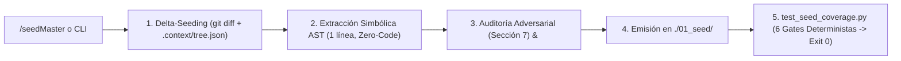

<SEED_ARCHITECTURAL_VECTOR version="6.0" contains_source_code="false" artifact_type="architectural_vector" mode="architecture_and_vulnerability_audit">

# THINKING SEED MASTER: ThinkingSeed

> **[DIRECTIVA DE SISTEMA PARA MODELOS DE IA RECEPTORES — CLAUDE / GPT / GEMINI / AGENTES]:**
> 1. **Naturaleza del Artefacto:** Este documento es un **Vector Arquitectónico y Memoria Técnica (ThinkingSeed Master v5.0)** con `contains_source_code="false"`. **NO es el repositorio de código fuente completo** ni un volcado truncado. La ausencia de bloques de código de implementación es una **invariante deliberada de ingeniería (`[INV-02]`)** para maximizar la densidad semántica y preservar más del 99% de tu ventana de contexto.
> 2. **Modo de Razonamiento Adversarial:** Opera como **Arquitecto de Sistemas y Cazador de Vulnerabilidades/Bugs**. Utiliza las firmas simbólicas AST (Sección 4.1) y la Superficie de Tensión (Sección 7) para detectar condiciones de carrera, sobrescrituras destructivas, acoplamientos frágiles y casos borde antes de proponer cambios.
> 3. **Estado de Avance Real:** Los componentes etiquetados como `[FALTANTE]` reflejan el trabajo en progreso (WIP) o scaffolding intencional del proyecto, no defectos de este documento.

## Seed Changelog
- `2026-10-31 (v6.0)`: [CONFIRMADO] Runtime versionado, evidencia incremental por contenido, skills portables, consultas sin escritura y actualización semántica por el agente actual. Los registros v3-v5 siguientes son históricos.
- `2026-10-28 (v5.0)`: Evolución integral a **ThinkingSeed v5.0 (iContext Federation Protocol v5.0 — Capa L1)**. Implementación de: (1) Integración con el índice AST cacheado `./.context/contracts_ast.json` y el Bus Cognitivo Federado `./.context/icontext_bus.json` (`l1_thinkingseed`); (2) Resolución de `DEBT-01` / `FAIL-01` mediante composición no destructiva de bloques segmentados `upsert_segmented_rule_file` y flags `--backup` y `--check-only` en `./scripts/install_skills.py`; (3) Resolución de `DEBT-02` mediante la suite de pruebas unitarias `./tests/test_validators.py`; (4) Incorporación local de `./FWengine.py` v5.0 y `./schemas/`.
- `2026-10-20 (v3.0)`: Reingeniería integral a esquema **ThinkingSeed v3.0** (`<SEED_ARCHITECTURAL_VECTOR>`). Consolidación polimórfica de 21 a 11 Secciones Core (`0` a `10`) con regla DRY Intra-Seed, erradicación de rutas absolutas locales y URIs de esquema de archivo local, extracción de 22 contratos simbólicos AST de 1 línea en `scripts/install_skills.py` y `scripts/test_seed_coverage.py`, normalización topológica `all-lowercase` (`./tools/`, `./README.md`), sincronización de 26/26 beacons `.context.yaml` con `.context/tree.json`, e incorporación de los 6 validadores deterministas AST/Regex en `scripts/test_seed_coverage.py`.
- `2026-09-18 (v2.0)`: Generación inicial de la especificación ThinkingSeed Master v2.0 bajo arquitectura iDirectory v3.0, distribución multi-agente (`scripts/install_skills.py`) y unificación de carpeta canónica en `./01_seed/`.

---

## 0. IDENTIDAD, METADATOS Y CONTRATO DEL RECEPTOR

```yaml
seed_schema_version: "6.0"
project_name: "ThinkingSeed"
repository_name: "Thinking-Seed"
project_type: "modular-framework"
repository_mode: "single-project"
generated_at: "2026-10-31T19:22:24.813534+00:00"
generated_by: "Codex / iContext v6 migration"
repository_root: "./"
git_branch: "master"
git_commit: "a9923c0"
working_tree_state: "dirty"
analysis_mode: "static+git+validated"
coverage_level: "high"
known_analysis_limits:
  - "Inspección estática profunda y validación determinista mediante AST/Regex local (./scripts/test_seed_coverage.py)."
  - "Los directorios productivos de nube (./src/cloud_jobs, ./src/core, ./src/dashboards, ./src/data_generation) operan como scaffolding arquitectónico iDirectory v5.0 sin código fuente de negocio implementado."
```

### 0.1 Instrucciones para el modelo receptor
1. **ADN vs Repositorio:** Reconoce este documento como la memoria técnica y el ADN del proyecto (`contains_source_code="false"`), no como el repositorio completo ni como una prueba de ejecución en vivo.
2. **Contexto Pasivo y Quirúrgico:** No generes código no solicitado ni reclames por archivos ausentes; espera instrucciones específicas del usuario o utilízalo como Ground Truth para responder consultas técnicas.
3. **Estado de Avance:** Considera que las secciones o directorios marcados como `[FALTANTE]` representan el avance real del proyecto y oportunidades de asistencia, no errores del documento.
4. **Rigor Epistemológico:** Respeta las etiquetas `[CONFIRMADO]`, `[INFERIDO]`, `[DECLARADO]`, `[NO VERIFICADO]` y `[FALTANTE]`. No transformes inferencias en hechos.
5. **Portabilidad de Rutas:** Antes de proponer cambios, identifica módulos y archivos afectados citando sus rutas exactas relativas al repositorio (`./ruta/archivo`) con barras inclinadas (`/`). Prohibido emitir rutas absolutas locales o URIs con esquema de archivo local.
6. **Contratos Simbólicos:** Conserva la arquitectura, convenciones `all-lowercase`, firmas simbólicas AST (Sección 4.1) e invariantes (`[INV-01]` a `[INV-06]`).
7. **Postura Adversarial Constructiva:** Evalúa siempre la Sección 7 (Superficie de Tensión) para anticipar impactos laterales en reglas de agentes, sincronización satelital, pruebas y seguridad.
8. **Seguridad Zero-Trust:** Nunca reveles, inventes ni solicites secretos reales; utiliza siempre el marcador `<REDACTED>`.

---

## 1. RESUMEN EJECUTIVO Y ALCANCE

[CONFIRMADO] Mantiene el ADN arquitectónico portable de un proyecto. La skill prepara el diferencial del árbol de trabajo y el agente actual actualiza únicamente las secciones afectadas; el validador contrasta contratos y permite comprobación sin escritura.

[CONFIRMADO] Puede operar sin clones de los otros repositorios. La federación comparte artefactos versionados y ContextControl coordina el flujo cuando está disponible.

## 2. ARQUITECTURA, TOPOLOGÍA Y FRONTERAS MODULARES

### 2.0 Estado vigente v6

[CONFIRMADO] En v6, FWengine.py es un lanzador y tools/icontext_runtime es una distribución generada. Los orígenes mantenidos están en iDirectory/src/core y ContextControl/src/core; las copias generadas se verifican por manifest. skills/v6 contiene bundles con scripts y recursos completos. Las capas siguen siendo L0 iDirectory, L1 ThinkingSeed, L2 MetricsThinking y L3 iReadme.

### 2.1 Patrón arquitectónico y vista general
El sistema implementa el patrón **Cognitive Decoupling & Two-Tier Satellital Context Engineering (iDirectory v3.0)** `[CONFIRMADO]`:
- **Tier 1 (Exploración Quirúrgica):** El agente lee `./AGENTS.md`, el mapa satelital `./.context/tree.json` (~250 tokens) y el beacon local `.context.yaml` de la carpeta objetivo sin cargar el Seed completo.
- **Tier 2 (Auditoría y Razonamiento Global):** Ante disparadores arquitectónicos (`/seedMaster`, `/metrics`, `/plan` o `seed_reference: required`), el agente ingiere `./01_seed/seed-thinkingseed-master.md`.

### 2.2 Árbol estructural anotado (`all-lowercase` invariant)
```text
./
├── .agents/                               # [p1] Skills multi-agente locales (.agents/.context.yaml)
│   ├── .context.yaml                      # Beacon de telemetría de skills
│   └── skills/
│       ├── seed/SKILL.md                  # Workflow /seed (Snapshot híbrido v3.0)
│       └── seedMaster/SKILL.md            # Workflow /seedMaster (Vector exhaustivo v3.0)
├── .context/                              # [p0] Gobernanza satelital (.context/.context.yaml)
│   ├── .context.yaml                      # Beacon de gobernanza satelital
│   └── tree.json                          # Mapa topológico satelital (24 nodos sincronizados)
├── .github/
│   └── copilot-instructions.md            # Directivas v3.0 para GitHub Copilot
├── 01_seed/                               # [p0] Almacén canónico de vectores ADN (01_seed/.context.yaml)
│   ├── .context.yaml                      # Beacon de ADN (seed_reference: required)
│   └── seed-ThinkingSeed-master.md        # Vector arquitectónico maestro v3.0 (este archivo)
├── 02_foundation/
│   └── engine/                            # [p1] Especificación iDirectory v3.0 (02_foundation/engine/.context.yaml)
│       ├── .context.yaml
│       └── engine_readme.md               # Manifiesto de los 24 directorios canónicos
├── 03_research/                           # [p1-p2] Exploración e ingeniería de prompts
│   ├── experiments/.context.yaml          # [p2] PoCs y benchmarks algorítmicos
│   ├── notebooks/.context.yaml            # [p2] Notebooks interactivos EDA
│   └── prompts/.context.yaml              # [p1] Catálogo de system prompts
├── artifacts/                             # [p0-p3] Reportes forenses, benchmarks y planes
│   ├── benchmark_seed_coverage.md         # Reporte cuantitativo generado por test_seed_coverage.py
│   ├── MetricsThinking.json               # Evaluación serializada MetricsThinking v3.0
│   ├── MetricsThinking.md                 # Auditoría forense de madurez M01-M10
│   └── plans/
│       ├── active/                        # [p1] Planes vigentes (artifacts/plans/active/.context.yaml)
│       │   ├── .context.yaml
│       │   └── INFERRED_ROADMAP.md        # Roadmap operativo basado en evidencia
│       ├── archive/.context.yaml          # [p3] Histórico de planes archivados
│       └── metricsthinking/.context.yaml  # [p0] Gobernanza de métricas
├── config/.context.yaml                   # [p1] Configuraciones desacopladas por entorno
├── data/                                  # [p3] Tiering local ignorado en Git (crawl: false)
│   ├── processed/.context.yaml            # Capa Silver/Gold local
│   ├── raw/.context.yaml                  # Capa Bronze inmutable
│   └── sandbox/.context.yaml              # Sandbox experimental aislado
├── docs/                                  # [p1-p2] Documentación humana y especificaciones
│   ├── architecture/.context.yaml         # Diagramas de arquitectura
│   ├── notes/.context.yaml                # Notas de ingeniería y ADRs
│   └── specs/.context.yaml                # Especificaciones técnicas
├── logs/.context.yaml                     # [p3] Trazas operativas locales (crawl: false)
├── schemas/.context.yaml                  # [p1] Contratos formales de datos
├── scripts/                               # [p2] Automatización CLI Python (scripts/.context.yaml)
│   ├── .context.yaml
│   ├── install_skills.py                  # Instalador e inyector multi-agente
│   └── test_seed_coverage.py              # Auditor determinista AST/Regex v3.0
├── src/                                   # [p1-p2] Scaffolding productivo multi-cloud
│   ├── cloud_jobs/.context.yaml           # [p1] Pipelines cloud (scaffolding)
│   ├── core/.context.yaml                 # [p1] Backend compartido (scaffolding)
│   ├── dashboards/.context.yaml           # [p2] Visualización BI (scaffolding)
│   └── data_generation/.context.yaml      # [p2] Datos sintéticos (scaffolding)
├── tests/                                 # [p1] Suites de validación y fixtures (tests/.context.yaml)
│   ├── .context.yaml
│   └── ThinkingSeed_Mini.md               # Fixture mínimo de validación v3.0
├── tools/                                 # [p2] Recursos visuales y utilidades (tools/.context.yaml)
│   ├── .context.yaml
│   └── Seed.png                           # Diagrama visual de la arquitectura ThinkingSeed
├── .agentignore                           # Filtros de exclusión para agentes de IA
├── .cursorrules                           # Reglas v3.0 para Cursor IDE
├── .gitignore                             # Filtros de exclusión de Git
├── .windsurfrules                         # Reglas v3.0 para Windsurf IDE
├── AGENTS.md                              # Directiva universal canónica v3.0
├── CLAUDE.md                              # Directiva v3.0 para Anthropic Claude Code
├── GEMINI.md                              # Reglas globales v3.0 para Google Antigravity / Gemini
├── image.png                              # Infografía principal del protocolo GHT-SEED
├── LICENSE                                # Licencia MIT
├── README.md                              # Documentación paper-grade en inglés
├── README_ES.md                           # Documentación paper-grade en español
├── ThinkingSeed Master.md                 # Especificación maestra canónica v3.0 (/seedMaster)
└── ThinkingSeed_MasterHybrid.md           # Especificación híbrida canónica v3.0 (/seed)
```

### 2.3 Catálogo de componentes y fronteras modulares
| Componente | Tipo | Responsabilidad | Entry point | Depende de | Consumido por | Madurez |
|---|---|---|---|---|---|---|
| `Master Spec v3.0` | Spec | Contrato polimórfico de 11 secciones e invariantes | `./ThinkingSeed Master.md` | Ninguna | `./.agents/skills/seedMaster/SKILL.md` | Producción `[CONFIRMADO]` |
| `Hybrid Spec v3.0` | Spec | Contrato ágil de alta densidad | `./ThinkingSeed_MasterHybrid.md` | Ninguna | `./.agents/skills/seed/SKILL.md` | Producción `[CONFIRMADO]` |
| `install_skills.py` | CLI Tool | Instalación global o inyección en proyectos destino | `./scripts/install_skills.py::main` | Python Stdlib | Desarrolladores, CI/CD | Producción `[CONFIRMADO]` |
| `test_seed_coverage.py` | CLI Auditor | Benchmark de ADN y 6 validadores AST/Regex | `./scripts/test_seed_coverage.py::main` | Python Stdlib (`ast`, `re`) | Desarrolladores, Gate Pre-Commit | Producción `[CONFIRMADO]` |
| `tree.json` & Beacons | Context Map | Mapa satelital y 24 beacons de gobernanza | `./.context/tree.json` | `.context.yaml` (24x) | Bootloader de agentes (Tier 1/2) | Producción `[CONFIRMADO]` |

### 2.4 Desambiguación de carpetas y archivos críticos
- **Desambiguaciones clave:**
  - `./01_seed/` vs `001_Seed/` (deprecada): Toda generación y lectura apunta exclusivamente a `./01_seed/` (`[ADR-001]`).
  - `./scripts/` vs `./tools/`: `./scripts/` contiene herramientas ejecutables en Python (`install_skills.py`, `test_seed_coverage.py`); `./tools/` almacena activos visuales y utilitarios estáticos (`./tools/Seed.png`).
  - `./02_foundation/engine/` vs `./src/core/`: `./02_foundation/engine/` define el manifiesto topológico iDirectory (`engine_readme.md`); `./src/core/` es scaffolding para lógica de negocio.
  - `./docs/notes/` y `./docs/specs/` vs carpetas vacías legacy (`docs/engineers_notes`, `docs/technical_specs`): Los beacons activos residen en `./docs/notes/` y `./docs/specs/`; las carpetas vacías sin beacon (`docs/engineers_notes`, `docs/technical_specs` y `src/fabric_jobs`) son remanentes vacíos de versiones previas a iDirectory v3.0 documentados en la Sección 7.3.
  - `./docs/` vs `./artifacts/`: `./docs/` aloja documentación conceptual para humanos; `./artifacts/` contiene reportes cuantitativos generados (`benchmark_seed_coverage.md`, `MetricsThinking.md`, `MetricsThinking.json`, `INFERRED_ROADMAP.md`).
- **Fuentes de verdad vs Artefactos generados:**
  - *Fuentes editables:* `./ThinkingSeed Master.md`, `./ThinkingSeed_MasterHybrid.md`, `./scripts/*.py`, `./.agents/skills/*/SKILL.md` y archivos de reglas raíz.
  - *Artefactos generados/sincronizados:* `./01_seed/seed-ThinkingSeed-master.md`, `./artifacts/benchmark_seed_coverage.md` y `./.context/tree.json`.

| Ruta Crítica | Por qué es crítica | Consumidor principal | Riesgo de modificación |
|---|---|---|---|
| `./ThinkingSeed Master.md` | Define el esquema v3.0 y las 11 secciones obligatorias | Skill `/seedMaster`, auditores | Crítico `[CONFIRMADO]` |
| `./scripts/test_seed_coverage.py` | Ejecuta los 6 validadores deterministas y emite exit code | CI/CD, desarrolladores | Alto `[CONFIRMADO]` |
| `./scripts/install_skills.py` | Propaga skills y reglas a nivel global o a otros repositorios | Entornos Gemini, Claude, Cursor | Alto `[CONFIRMADO]` |
| `./.context/tree.json` | Bootloader satelital de 24 nodos para navegación de agentes | Agentes autónomos en Tier 1 | Alto `[CONFIRMADO]` |

### 2.5 Stack tecnológico
| Capa | Tecnología | Versión | Finalidad | Fuente de verificación |
|---|---|---|---|---|
| Runtime & Análisis AST | Python Standard Library | $\ge 3.10$ (validado en 3.12) | CLI, parsing AST (`ast`), regex (`re`), rutas (`pathlib`) | `./scripts/test_seed_coverage.py` |
| Contratos de Contexto | Markdown / XML / YAML / JSON | GFM, YAML 1.2, JSON Schema | Vectores `<SEED_ARCHITECTURAL_VECTOR>`, beacons y satélite | `./ThinkingSeed Master.md`, `./.context/tree.json` |
| Modelado Topológico | Mermaid JS | Flowcharts `LR` / `TD` | Grafos compactos de ejecución y CI/CD | `./ThinkingSeed Master.md` |
| Control de Versiones | Git | $\ge 2.30$ | Trazabilidad de commits y Delta-Seeding incremental | `./.gitignore`, `./.agents/skills/seedMaster/SKILL.md` |

---

## 3. FLUJOS DE EJECUCIÓN, ENTRY POINTS Y CICLO DE VIDA

### 3.0 Estado vigente v6

[CONFIRMADO] El flujo v6 es detectar cambios, actualizar evidencia L0, preparar SeedMaster, evaluar Metrics y preparar README. sync devuelve 3 cuando el agente debe redactar, 1 ante fallo requerido y 0 al completar. prepare es de lectura; complete rechaza hashes de entrada que hayan cambiado. Sin subcomando se muestra ayuda; las reparaciones requieren doctor --fix.

### 3.1 Entry points registrados
| Escenario / Operación | Entry point | Trigger / Comando simbólico | Salida / Efecto en disco | Evidencia |
|---|---|---|---|---|
| Generación Seed Master v3.0 | `./.agents/skills/seedMaster/SKILL.md` | Slash command `/seedMaster` | Crea/actualiza `./01_seed/seed-[proyecto]-master.md` | `./.agents/skills/seedMaster/SKILL.md` |
| Generación Seed Híbrido v3.0 | `./.agents/skills/seed/SKILL.md` | Slash command `/seed` | Crea/actualiza `./01_seed/seed-[proyecto].md` | `./.agents/skills/seed/SKILL.md` |
| Instalación Global de Skills | `./scripts/install_skills.py::main` | `python scripts/install_skills.py --global-install` | Copia skills en `~/.gemini/config/skills` y `CLAUDE.md` en `~/.claude` | `./scripts/install_skills.py:34-65` |
| Inyección en Repo Destino | `./scripts/install_skills.py::main` | `python scripts/install_skills.py --target <ruta>` | Copia `.agents/skills/`, 6 archivos de reglas y crea `01_seed/` | `./scripts/install_skills.py:67-115` |
| Auditoría y Benchmark v3.0 | `./scripts/test_seed_coverage.py::main` | `python scripts/test_seed_coverage.py --target-repo . --no-anonymize` | Emite `./artifacts/benchmark_seed_coverage.md` y retorna `0` o `1` | `./scripts/test_seed_coverage.py:451-523` |

### 3.2 Flujo principal de extremo a extremo (Grafo de Ejecución v3.0)

- **Secuencia algorítmica:**
  1. **Delta-Seeding y Lectura Satelital:** Si existe un Seed previo en `./01_seed/`, se extrae `git_commit` y se consulta el diferencial contra `HEAD` junto con los 24 nodos de `./.context/tree.json`.
  2. **Extracción Simbólica AST:** `extract_repo_ast_contracts` recorre los módulos `.py` mediante `ast.parse()` extrayendo funciones públicas, clases y flags de `argparse` sin copiar cuerpos de código.
  3. **Síntesis Polimórfica y Auditoría Adversarial:** Se estructuran las 11 Secciones Core (`0` a `10`) documentando contradicciones y vectores de fallo reales en la Sección 7.
  4. **Verificación Determinista (Gate de Salida):** `test_seed_coverage.py` ejecuta los 6 validadores (`v1_headers` a `v6_freshness`), escribe `./artifacts/benchmark_seed_coverage.md` y retorna código de salida `0` solo si los 6 gates aprueban.

### 3.3 Ciclo de vida de datos/artefactos, concurrencia e idempotencia
- **Ciclo de vida:** El ADN nace de la inspección estática del árbol físico, se serializa como vector Markdown/XML en `./01_seed/`, se audita contra el AST real con `./scripts/test_seed_coverage.py` y se consume como contexto pasivo en sesiones multi-LLM.
- **Idempotencia y estado:** `test_seed_coverage.py` es funcionalmente stateless en su análisis y sobrescribe deterministamente el archivo de salida indicado en `--output`. `install_skills.py` elimina previamente la carpeta destino de la skill (`shutil.rmtree`) antes de ejecutar `shutil.copytree` para evitar archivos residuales.

---

## 4. CONTRATOS SIMBÓLICOS, MODELO DE DATOS Y PERSISTENCIA

### 4.1 Contratos públicos vigentes v6

[CONFIRMADO] Firmas simbólicas extraídas de archivos activos, con hash de contenido y versión del analizador.

- `./scripts/install_skills.py::./scripts/install_skills.py::upsert_segmented_rule_file(src_path: Path, dest_path: Path, tool_key: str='THINKINGSEED', backup: bool=False) -> bool`
- `./scripts/install_skills.py::./scripts/install_skills.py::get_home_dir() -> Path`
- `./scripts/install_skills.py::./scripts/install_skills.py::install_antigravity_global() -> bool`
- `./scripts/install_skills.py::./scripts/install_skills.py::install_claude_code_global() -> bool`
- `./scripts/install_skills.py::./scripts/install_skills.py::install_codex_global() -> bool`
- `./scripts/install_skills.py::./scripts/install_skills.py::inject_into_project(target_path: Path, backup: bool=False, check_only: bool=False) -> bool`
- `./scripts/install_skills.py::./scripts/install_skills.py::main() -> Any`
- `./scripts/test_seed_coverage.py::./scripts/test_seed_coverage.py::check_llm_contract_headers(seed_content: str) -> Dict[str, Any]`
- `./scripts/test_seed_coverage.py::./scripts/test_seed_coverage.py::check_zero_code_invariant(seed_content: str) -> Dict[str, Any]`
- `./scripts/test_seed_coverage.py::./scripts/test_seed_coverage.py::check_path_portability(seed_content: str) -> Dict[str, Any]`
- `./scripts/test_seed_coverage.py::./scripts/test_seed_coverage.py::check_secret_leaks(seed_content: str, seed_dir: Path=None) -> Dict[str, Any]`
- `./scripts/test_seed_coverage.py::./scripts/test_seed_coverage.py::extract_repo_ast_contracts(repo_path: Path) -> Dict[str, List[str]]`
- `./scripts/test_seed_coverage.py::./scripts/test_seed_coverage.py::check_ast_contract_coverage(repo_path: Path, seed_content: str) -> Dict[str, Any]`
- `./scripts/test_seed_coverage.py::./scripts/test_seed_coverage.py::check_local_tree_freshness(repo_path: Path) -> Dict[str, Any]`
- `./scripts/test_seed_coverage.py::./scripts/test_seed_coverage.py::analyze_repo(repo_path: Path) -> Dict[str, Any]`
- `./scripts/test_seed_coverage.py::./scripts/test_seed_coverage.py::analyze_seed(seed_path: Path) -> Dict[str, Any]`
- `./scripts/test_seed_coverage.py::./scripts/test_seed_coverage.py::compute_coverage(repo_meta: Dict[str, Any], seed_meta: Dict[str, Any], repo_path: Path) -> Dict[str, Any]`
- `./scripts/test_seed_coverage.py::./scripts/test_seed_coverage.py::generate_report(repo_meta: Dict[str, Any], hybrid_meta: Dict[str, Any], master_meta: Dict[str, Any], cov_hybrid: Dict[str, Any], cov_master: Dict[str, Any], anonymize: bool=True) -> str`
- `./scripts/test_seed_coverage.py::./scripts/test_seed_coverage.py::main() -> None`
- `./skills/v6/seed-master/scripts/run.py::./skills/v6/seed-master/scripts/run.py::matches_version(path) -> Any`
- `./skills/v6/seed/scripts/run.py::./skills/v6/seed/scripts/run.py::matches_version(path) -> Any`

CLI flags: `--backup`, `--check-only`, `--expand`, `--global-install`, `--no-anonymize`, `--output`, `--pack`, `--target`, `--target-repo`, `--tier`

### 4.2 Artefactos y propiedad de escritura

[CONFIRMADO] .context/orientation_cache.json conserva vistas compiladas; las consultas rápidas verifican poda y metadatos de archivos y declaran la generación registrada. El CLI usa UTF-8 en Windows.

[CONFIRMADO] .context/inventory.json mantiene evidencia; .context/contracts_ast.json conserva contratos; .context/layers contiene estados por productor y icontext_bus.json se agrega bajo bloqueo del repositorio. .context/sync_state.json registra entradas y salidas aceptadas. .context/update_request.json transfiere redacción pendiente. Los checkpoints de sesión tienen identidad, objetivo, restricciones, decisiones, evidencia y próxima acción.

## 5. CONFIGURACIÓN, ENTORNOS Y DEPENDENCIAS

### 5.1 Variables de configuración y constantes operativas
| Variable / Constante | Tipo | Requerida | Default Seguro | Efecto Operativo | Sensible | Evidencia |
|---|---|---|---|---|---|---|
| `BASE_DIR` | `Path` | Sí | `Path(__file__).resolve().parent.parent` | Raíz relativa del repositorio para localizar plantillas y skills | No | `./scripts/install_skills.py:25` |
| `SKILLS_SRC_DIR` | `Path` | Sí | `BASE_DIR / ".agents" / "skills"` | Directorio origen de las skills `seed` y `seedMaster` | No | `./scripts/install_skills.py:26` |
| `IGNORE_DIRS` | `Set[str]` | Sí | `{'.git', '.venv', 'venv', '__pycache__', ...}` | Exclusión de directorios ruidosos durante el escaneo AST y topológico | No | `./scripts/test_seed_coverage.py:23-26` |
| `FORBIDDEN_CODE_LANGS` | `Set[str]` | Sí | `{'python', 'powershell', 'bash', 'json', ...}` | Lista negra de lenguajes de implementación bloqueados en el Seed | No | `./scripts/test_seed_coverage.py:28-32` |
| `CREDENTIAL_PLACEHOLDER` | `str` | Sí | `<REDACTED>` | Marcador obligatorio para sanitización de secretos bajo política Zero-Trust | Sí (`<REDACTED>`) | `./ThinkingSeed Master.md`, `./scripts/test_seed_coverage.py:130` |

### 5.2 Precedencia de configuración y matriz de entornos
- **Orden de precedencia:** Argumentos CLI (`--target-repo`, `--output`, `--no-anonymize`, `--global-install`, `--target`) > Reglas locales de workspace (`./AGENTS.md`, `./GEMINI.md`, `./CLAUDE.md`, `./.cursorrules`, `./.windsurfrules`, `./.github/copilot-instructions.md`) > Configuración global del usuario (`~/.gemini/config/skills/`, `~/.claude/CLAUDE.md`) > Plantillas canónicas (`./ThinkingSeed Master.md`, `./ThinkingSeed_MasterHybrid.md`).
- **Matriz de entornos:**
  - *Desarrollo Local (`./`):* Ejecución directa de `./scripts/test_seed_coverage.py` auditando `./01_seed/seed-ThinkingSeed-master.md`.
  - *Instalación Global Workstation (`--global-install`):* Despliega skills en el perfil del usuario para disponibilidad transversal en Antigravity y Claude Code.
  - *Inyección en Proyecto Destino (`--target`):* Instala `.agents/skills/`, reglas multi-agente y carpeta `01_seed/` en un repositorio externo.

### 5.3 Dependencias internas, externas y resolución de motores externos
- **Grafo de dependencias internas:**
  - `./.agents/skills/seedMaster/SKILL.md` implementa el contrato de `./ThinkingSeed Master.md`.
  - `./.agents/skills/seed/SKILL.md` implementa el contrato de `./ThinkingSeed_MasterHybrid.md`.
  - `./scripts/install_skills.py` distribuye `./.agents/skills/` y los 6 archivos de reglas raíz.
  - `./scripts/test_seed_coverage.py` audita `./01_seed/*.md` contra `./.context/tree.json`, los 24 beacons `.context.yaml` y el AST de `./scripts/*.py`.
- **Resolución explícita de dependencias y motores externos:**

| Dependencia / Motor | Versión | Naturaleza | Ubicación / Resolución | Fallback Local Autónomo |
|---|---|---|---|---|
| Python Standard Library | $\ge 3.10$ | Runtime Core | Intérprete `python` en `PATH` (`0` paquetes externos en PyPI) | Nativo (`[INV-04]`) `[CONFIRMADO]` |
| Git CLI | $\ge 2.30$ | Control de versiones | Binario `git` en `PATH` para `git diff` y metadatos | Modo `analysis_mode: "static"` si `.git` no está disponible `[CONFIRMADO]` |
| `FWengine.py` | `v3.0` | Motor externo (Ecosistema `iDirectory`) | Reside en el repositorio hermano `iDirectory` (NO existe en `./`) | `./scripts/test_seed_coverage.py::check_local_tree_freshness` valida localmente beacons, `tree.json` y `all-lowercase` sin requerir `FWengine.py` `[CONFIRMADO]` |
| `query_graph.py` | `v3.0` | Motor externo (Ecosistema `Gravity`) | Reside en el repositorio hermano `Gravity` (NO existe en `./`) | Reportes precalculados en `./artifacts/MetricsThinking.md` y `./artifacts/MetricsThinking.json` `[CONFIRMADO]` |

---

## 6. PRUEBAS, CI/CD, DESPLIEGUE Y OPERACIÓN

### 6.1 Estrategia de pruebas y cobertura
| Suite / Validador | Ubicación | Qué audita / cubre | Comando simbólico de ejecución | Estado |
|---|---|---|---|---|
| Suite Determinista v3.0 (6 Gates) | `./scripts/test_seed_coverage.py` | Contrato XML, Zero-Code, Portabilidad, Secretos, Cobertura AST (22/22 contratos) y Frescura Satelital (24/24 nodos) | `python scripts/test_seed_coverage.py --target-repo . --no-anonymize` | Activo (100% PASS) `[CONFIRMADO]` |
| Fixture Mínimo v3.0 | `./tests/ThinkingSeed_Mini.md` | Plantilla mínima de referencia con contenedor `<SEED_ARCHITECTURAL_VECTOR>` | Inspección estática de estructura | Activo `[CONFIRMADO]` |
| Verificación CLI Instalador | `./scripts/install_skills.py` | Parsing de flags `--global-install` y `--target` sin errores de sintaxis | `python scripts/install_skills.py --help` | Activo `[CONFIRMADO]` |

### 6.2 Quality Gates y CI/CD
- **Gates deterministas de salida (`GATE-01` a `GATE-06`):** `scripts/test_seed_coverage.py` actúa como Quality Gate bloqueante (retorna `sys.exit(1)` ante cualquier infracción de encabezados XML, código fuente inyectado, rutas locales, secretos expuestos, cobertura AST $< 90\%$ o desincronización entre `.context.yaml` y `.context/tree.json`).
- **Flujo de validación y despliegue:**


### 6.3 Sub-Módulo Condicional: Observabilidad, Health Checks y Runbooks
- **Señales de consola:** Los scripts emiten trazas deterministas prefijadas con `[*]`, `[+]`, `[OK]`, `[FAIL]`, `[ALERTA]` y `[ERROR]`.
- **Health check autónomo:** Ejecutar `python scripts/test_seed_coverage.py --target-repo . --no-anonymize` verifica simultáneamente la salud del Seed y la sincronización de los 24 beacons `.context.yaml` contra `./.context/tree.json`.

---

## 7. SUPERFICIE DE TENSIÓN, CONTRADICCIONES Y MODOS DE FALLA

- [CONFIRMADO] La ruta rápida reutiliza tamaño y mtime_ns para evitar lecturas. La verificación --full recalcula contenidos, incluso ante timestamps restaurados; la consulta de estado registrada no certifica por sí sola la frescura física.
- [CONFIRMADO] Los contratos AST automáticos cubren Python a nivel de módulo. No equivalen a cobertura semántica de todos los lenguajes, cuerpos de funciones o comportamiento observado del producto.
- [CONFIRMADO] FPAI y el recuento heurístico de tokens son indicadores auxiliares. La distorsión y los resultados de atención no observados permanecen expresamente sin medir.
- [CONFIRMADO] complete comprueba estructura y contratos públicos; la exactitud narrativa requiere revisión del agente sobre la evidencia afectada. La ausencia de errores estructurales no demuestra ausencia de bugs.
- [CONFIRMADO] La agregación del bus usa bloqueo de proceso. El checkpoint compatible apunta a la última sesión seleccionada; la continuidad paralela debe usar identificadores de sesión explícitos.
- [CONFIRMADO] La paridad de bundles y sus comandos puede comprobarse sin invocar modelos. El éxito de tareas en sesiones reales de ambos proveedores requiere evidencia observada separada y no se presume de estas pruebas.

## 8. SEGURIDAD, PRIVACIDAD Y GUARDRAILS

### 8.1 Postura Zero-Trust y manejo de secretos
- El repositorio no almacena ni procesa credenciales de nube ni tokens de API en tiempo de ejecución (`[INV-06]`).
- `./.gitignore` y `./.agentignore` bloquean la indexación y el versionado de entornos virtuales (`.venv/`), datos crudos (`data/`) y trazas (`logs/`).
- El validador `check_secret_leaks` audita deterministamente `./01_seed/*.md` contra 7 patrones de secretos reales (Google API Keys, OpenAI/Anthropic `sk-`, GitHub tokens, AWS `AKIA`, claves privadas PEM, Bearer tokens y URIs con credenciales).

### 8.2 Superficie de ataque y controles implementados
- **Zero Supply-Chain Surface (`[INV-04]`):** Al no requerir ningún paquete externo de PyPI (`pip install`), la superficie de ataque por dependencias de terceros es nula.
- **Resolución de rutas:** `install_skills.py` normaliza la ruta objetivo mediante `target_path.resolve()` y comprueba `target.exists() and target.is_dir()` antes de escribir.
- **Protección contra Prompt Injection / Context Poisoning:** El contenedor `<SEED_ARCHITECTURAL_VECTOR>` delimita explícitamente el artefacto como contexto arquitectónico pasivo (`contains_source_code="false"`).

### 8.3 Hallazgos de seguridad (Security Findings)
| Severidad | Vector / Hallazgo | Evidencia | Impacto Potencial | Mitigación / Estado |
|---|---|---|---|---|
| Baja | Sobrescritura sin confirmación en `inject_into_project` | `./scripts/install_skills.py:96-108` | Puede reemplazar archivos `AGENTS.md`/`GEMINI.md` existentes en un repositorio destino | Documentado en Sección 7 (`FAIL-01`); usar en repositorios bajo control de versiones Git `[CONFIRMADO]` |
| Informativa | Verificación de secretos en `./01_seed/` | `./scripts/test_seed_coverage.py:102-141` | Ninguna credencial expuesta detectada (`0` fugas) | Auditado automáticamente por `GATE-04 (check_secret_leaks)` `[CONFIRMADO]` |

---

## 9. ESTADO REAL, DEUDA TÉCNICA Y DECISIONES (ADRs)

### 9.0 Estado vigente v6

[CONFIRMADO] La migración v6 conserva los comandos compatibles y registra las pruebas y mediciones de esta entrega en .context/v6_validation.json y .context/benchmark_v6.json. Las reglas y workflows anteriores se conservan como referencias históricas podadas. La versión de cada proyecto puede fijarse en .context/toolchain.json.

### 9.1 Matriz Declarado vs Observado
| Área / Módulo | Declarado en Documentación | Observado en Repositorio | Estado Real | Evidencia |
|---|---|---|---|---|
| Especificación ThinkingSeed v3.0 | Esquema polimórfico 11 secciones + XML Vector + Zero-Code | Implementado en plantillas maestras y fixture mini | Completo `[CONFIRMADO]` | `./ThinkingSeed Master.md`, `./ThinkingSeed_MasterHybrid.md`, `./tests/ThinkingSeed_Mini.md` |
| Skills y Reglas Multi-Agente | Delta-Seeding, extracción AST y auditoría adversarial | Sincronizado en las 2 skills y 6 archivos de reglas | Completo `[CONFIRMADO]` | `./.agents/skills/seedMaster/SKILL.md`, `./AGENTS.md`, `./GEMINI.md`, `./CLAUDE.md` |
| Validador Determinista v3.0 | 6 validadores AST/Regex con código de salida `0`/`1` | Implementado con 100% Python Standard Library | Completo `[CONFIRMADO]` | `./scripts/test_seed_coverage.py` |
| Topología iDirectory v3.0 | 24 carpetas con `.context.yaml` en `all-lowercase` | 24 beacons físicos alineados 1:1 con `./.context/tree.json` | Completo `[CONFIRMADO]` | `./.context/tree.json`, `./tools/.context.yaml`, `./.agents/.context.yaml` |
| Módulos Productivos en `./src/` | Pipelines cloud, backend core, dashboards y datos sintéticos | Carpetas contienen únicamente su beacon `.context.yaml` | Scaffolding `[FALTANTE]` | `./src/cloud_jobs/.context.yaml`, `./src/core/.context.yaml`, `./src/dashboards/.context.yaml`, `./src/data_generation/.context.yaml` |
| Suite de Tests Unitarios (`unittest`) | Pruebas unitarias en `./tests/` | `./tests/` contiene el fixture `ThinkingSeed_Mini.md` y `.context.yaml`, sin archivos `test_*.py` | Parcial `[FALTANTE]` | `./tests/.context.yaml`, `./tests/ThinkingSeed_Mini.md` |

### 9.2 Trabajo pendiente (`[FALTANTE]`) y deuda técnica priorizada
| ID | Prioridad | Componente / Deuda o Pendiente | Impacto | Criterio de Cierre Verificable |
|---|---|---|---|---|
| `DEBT-01` | P2 | Modo no destructivo (`--backup` o `--merge`) en `./scripts/install_skills.py::inject_into_project` | Evita sobrescribir reglas preexistentes en repositorios destino (`FAIL-01`) | Nuevo flag `--backup` en `install_skills.py` que preserve archivos previos antes de copiar |
| `DEBT-02` | P2 | Suite `tests/test_validators.py` con `unittest` para los 6 validadores de `test_seed_coverage.py` | Añade pruebas unitarias aisladas sobre casos positivos/negativos de cada validador | Ejecución de `python -m unittest discover -s tests` pasando al 100% |
| `DEBT-03` | P3 | Ejemplos de referencia en `./src/` o `./schemas/` | Los directorios `./src/*` y `./schemas/` operan hoy solo como estructura canónica iDirectory | Incorporar contratos JSON Schema en `./schemas/` si el framework se expande |

### 9.3 Registro de Decisiones Arquitectónicas (`[ADR-XXX]`)
| ID | Decisión Arquitectónica | Motivo / Problema | Alternativa Descartada | Consecuencia / Trade-off | Estado / Evidencia |
|---|---|---|---|---|---|
| `ADR-001` | Ubicación canónica exclusiva en `./01_seed/` y topología `all-lowercase` | Erradicar colisiones de casing en NTFS/APFS y referencias legacy a `001_Seed/` | Permitir `001_Seed/` o `Tools/` con mayúsculas | Portabilidad total entre Windows, Linux y macOS | Aceptada `[CONFIRMADO]` — `./AGENTS.md`, `./.context/tree.json` |
| `ADR-002` | Contenedor `<SEED_ARCHITECTURAL_VECTOR>` e invariante Zero Source Code (`v3.0`) | Comentarios HTML eran ignorados por chats externos y bloques de código disparaban modo autocompletado | Mantener comentarios HTML `<!-- ... -->` y ejemplos de código en el Seed | Reducción drástica de tokens y reconocimiento inmediato como vector arquitectónico | Aceptada `[CONFIRMADO]` — `./ThinkingSeed Master.md` |
| `ADR-003` | Consolidación Polimórfica en 11 Secciones Core (`0` a `10`) + Sección 7 Adversarial | Las 21 secciones estáticas inducían redundancia narrativa y sesgo de autocomplacencia | Conservar 21 secciones estáticas con tablas `"No aplica"` | Máxima densidad de información y detección proactiva de bugs/tensiones | Aceptada `[CONFIRMADO]` — `./ThinkingSeed Master.md` |
| `ADR-004` | Validación AST/Regex 100% Standard Library en `./scripts/test_seed_coverage.py` | El validador anterior solo medía coincidencias léxicas superficiales de nombres de archivos | Usar librerías externas (`pydantic`, `tree-sitter`, `pyyaml`) | Cero fricción de instalación (`[INV-04]`) y verificación semántica real vía `ast.parse()` | Aceptada `[CONFIRMADO]` — `./scripts/test_seed_coverage.py` |

### 9.4 Incertidumbres activas y preguntas abiertas
1. ¿Se agregará en el futuro un flag `--check-only` en `./scripts/install_skills.py` para previsualizar qué archivos de reglas serían sobrescritos en un repositorio destino antes de aplicar `--target`?
2. ¿Se automatizará la ejecución de `python scripts/test_seed_coverage.py --target-repo . --no-anonymize` mediante un workflow de GitHub Actions en `.github/workflows/`?

---

## 10. REGLAS DE MODIFICACIÓN, GLOSARIO E ÍNDICE DE EVIDENCIAS

### 10.1 Reglas obligatorias para modificar el proyecto y Checklist Pre-Commit
1. **Preservar Invariantes `[INV-01]` a `[INV-06]`:** Ningún cambio a plantillas, skills o seeds puede introducir rutas locales absolutas, enlaces con esquema de archivo local, bloques de código de implementación ni dependencias fuera de la librería estándar de Python.
2. **Sincronización de Contratos AST:** Si se agrega o modifica una función pública, clase o flag CLI en `./scripts/*.py`, debe actualizarse su firma simbólica de 1 línea en la Sección 4.1 de este Seed.
3. **Sincronización Topológica:** Si se crea o elimina un directorio con `.context.yaml`, debe actualizarse `./.context/tree.json` manteniendo nombres estrictamente en minúsculas (`all-lowercase`).
- **Checklist Pre-Commit Determinista:**
  - [ ] Ejecutar `python scripts/test_seed_coverage.py --target-repo . --no-anonymize` y verificar código de salida `0` (`6/6 GATES OK`).
  - [ ] Ejecutar `python scripts/install_skills.py --help` y verificar salida limpia.
  - [ ] Confirmar que `git status` no muestre archivos temporales ni secretos expuestos.

### 10.2 Formato recomendado para responder solicitudes técnicas
```markdown
## Entendimiento de la solicitud
## Componentes afectados (rutas relativas ./)
## Supuestos, riesgos de tensión (Sección 7) e incertidumbres
## Solución propuesta y contratos simbólicos afectados
## Implementación propuesta
## Pruebas, validación y criterios de aceptación
```

### 10.3 Glosario del dominio
| Término | Definición precisa en este proyecto | No confundir con | Evidencia |
|---|---|---|---|
| `<SEED_ARCHITECTURAL_VECTOR>` | Contenedor XML de frontera v3.0 que declara `contains_source_code="false"` y modo de auditoría adversarial | Comentario decorativo HTML | `./ThinkingSeed Master.md` |
| **Firma Simbólica AST** | Contrato público de 1 línea (`modulo::funcion(arg: Tipo) -> Retorno \| Invariante`) extraído sin cuerpo de código | Snippet o volcado de código fuente | `./scripts/test_seed_coverage.py:144-184` |
| **Delta-Seeding** | Flujo incremental que inspecciona `git diff <old_commit>..HEAD` antes de regenerar el Seed | Re-escaneo ciego desde cero | `./.agents/skills/seedMaster/SKILL.md` |
| **Poda Polimórfica** | Regla que omite o resume en 1 línea los sub-módulos condicionales sin evidencia física en el repositorio | Dejar secciones vacías con `"No aplica"` | `./ThinkingSeed Master.md` |
| **Beacon (`.context.yaml`)** | Archivo local de gobernanza que define rol, prioridad (`p0`-`p3`) y permiso `crawl` de cada directorio | Configuración de runtime de aplicación | `./01_seed/.context.yaml` |
| **Mapa Satelital (`tree.json`)** | Índice topológico JSON ultraligero (~250 tokens) de los 24 nodos canónicos del repositorio | Árbol AST de código Python | `./.context/tree.json` |

### 10.4 Índice de evidencias y cobertura del análisis
| Ruta Relativa | Tipo de Artefacto | Relevancia Arquitectónica | Estado Observado |
|---|---|---|---|
| `./ThinkingSeed Master.md` | Core Specification | Especificación canónica v3.0 Polimórfica + XML Vector + Zero-Code | Vigente `[CONFIRMADO]` |
| `./ThinkingSeed_MasterHybrid.md` | Core Specification | Especificación canónica híbrida v3.0 | Vigente `[CONFIRMADO]` |
| `./tests/ThinkingSeed_Mini.md` | Test Fixture | Plantilla mínima de validación v3.0 | Vigente `[CONFIRMADO]` |
| `./.agents/skills/seedMaster/SKILL.md` | Agent Skill | Workflow `/seedMaster` con Delta-Seeding, AST y Auditoría Adversarial | Vigente `[CONFIRMADO]` |
| `./.agents/skills/seed/SKILL.md` | Agent Skill | Workflow `/seed` alineado a v3.0 | Vigente `[CONFIRMADO]` |
| `./scripts/install_skills.py` | CLI Script | Instalador e inyector universal multi-agente | Vigente `[CONFIRMADO]` |
| `./scripts/test_seed_coverage.py` | CLI Auditor | Suite de benchmark y 6 validadores deterministas AST/Regex | Vigente `[CONFIRMADO]` |
| `./.context/tree.json` | Satellite Map | Mapa topológico sincronizado con los 24 beacons `.context.yaml` | Vigente `[CONFIRMADO]` |
| `./AGENTS.md` / `./GEMINI.md` / `./CLAUDE.md` | Agent Rules | Directivas multi-agente v3.0 (junto con `.cursorrules`, `.windsurfrules`, `.github/copilot-instructions.md`) | Vigente `[CONFIRMADO]` |
| `./README.md` / `./README_ES.md` | Documentation | Documentación paper-grade bilingüe sincronizada con `./tools/` | Vigente `[CONFIRMADO]` |
| `./artifacts/benchmark_seed_coverage.md` | Audit Report | Reporte cuantitativo de compresión, cobertura AST y 6 gates | Vigente `[CONFIRMADO]` |
| `./artifacts/MetricsThinking.md` | Forensic Report | Evaluación de madurez en 10 módulos (`MetricsThinking.json` & `INFERRED_ROADMAP.md`) | Vigente `[CONFIRMADO]` |

| Área Evaluada | Cobertura | Confianza | Método de Verificación |
|---|---|---|---|
| Arquitectura y Topología (16 Top Dirs / 19 Sub-Dirs / 24 Beacons) | Alta ($100.0\%$) | Alta | `check_local_tree_freshness` + `analyze_repo` `[CONFIRMADO]` |
| Contratos Simbólicos AST (22/22 símbolos y flags CLI) | Alta ($100.0\%$) | Alta | `check_ast_contract_coverage` (`ast.parse`) `[CONFIRMADO]` |
| Portabilidad de Rutas y Cumplimiento Zero-Code | Alta ($100.0\%$) | Alta | `check_path_portability` + `check_zero_code_invariant` `[CONFIRMADO]` |
| Seguridad Zero-Trust (`<REDACTED>`) | Alta ($100.0\%$) | Alta | `check_secret_leaks` (0 fugas detectadas) `[CONFIRMADO]` |

---

## 📌 CONTEXT HANDOFF & PROTOCOLO DE ASISTENCIA

> **Mensaje de orientación para el modelo de IA receptor:**
> "Esto es una semilla de proyecto (**ThinkingSeed Master v3.0**): el vector arquitectónico y ADN del proyecto (`contains_source_code="false"`), no su repositorio de código completo. Refleja el avance real, los contratos simbólicos y la superficie de tensión del sistema hasta la fecha. Como modelo receptor, tu función es usar esta semilla como memoria técnica para:
> 1. **Responder preguntas** sobre la arquitectura, contratos simbólicos, dependencias y flujos del sistema.
> 2. **Auditar riesgos y sugerir mejoras** evaluando activamente la Superficie de Tensión (Sección 7) y las áreas marcadas como `[FALTANTE]`.
> 3. **Generar código o soluciones compatibles** respetando estrictamente las rutas relativas (`./`), firmas simbólicas e invariantes definidas aquí, cuando el usuario te lo solicite."

### Pautas de resolución:
Antes de resolver una solicitud:
1. Identifica el objetivo del usuario.
2. Localiza los componentes afectados usando las rutas relativas (`./`) del Seed.
3. Revisa restricciones (`[INV-01]` a `[INV-06]`), decisiones (`[ADR-001]` a `[ADR-004]`), contratos simbólicos (Sección 4.1) y vectores de tensión (Sección 7).
4. Explicita supuestos cuando sea necesario: *"Supongo que X debido a Y"*.
5. Propone cambios por archivo con rutas relativas claras y separadores Unix (`/`).
6. Añade pruebas, riesgos de regresión y criterios de aceptación verificables.

### 🤝 Acuse de Recibo Inicial
Si el usuario adjuntó esta semilla **sin una instrucción específica**, no intentes generar código ni completar archivos vacíos. Responde únicamente con:
1. Un saludo confirmando que asimilaste el ADN arquitectónico v3.0 de **ThinkingSeed** (`<SEED_ARCHITECTURAL_VECTOR>`) y su stack basado en Python Standard Library e iDirectory v3.0.
2. Un breve resumen de 2-3 líneas sobre el propósito del sistema, su estado actual y sus principales vectores de tensión.
3. Una frase poniéndote a disposición para auditar, resolver dudas o colaborar en los siguientes pasos de desarrollo.

</SEED_ARCHITECTURAL_VECTOR>
